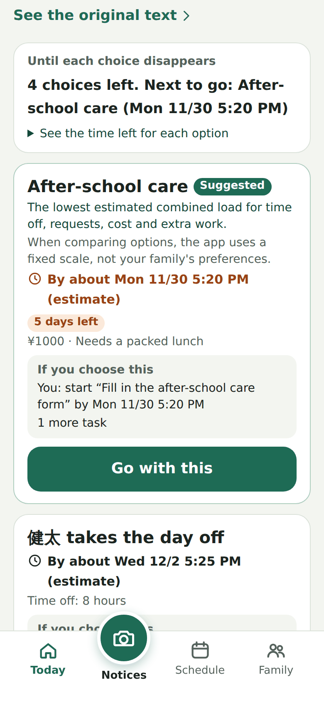
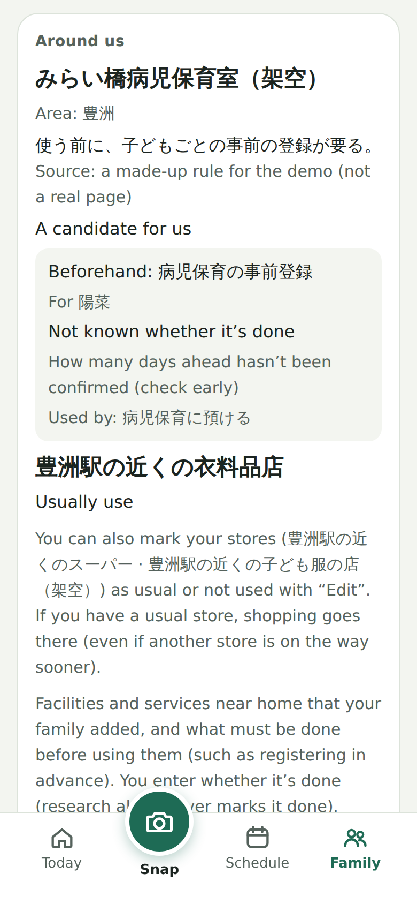
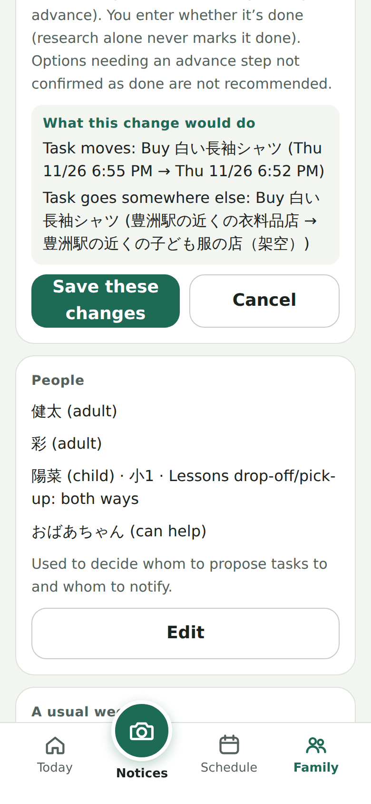
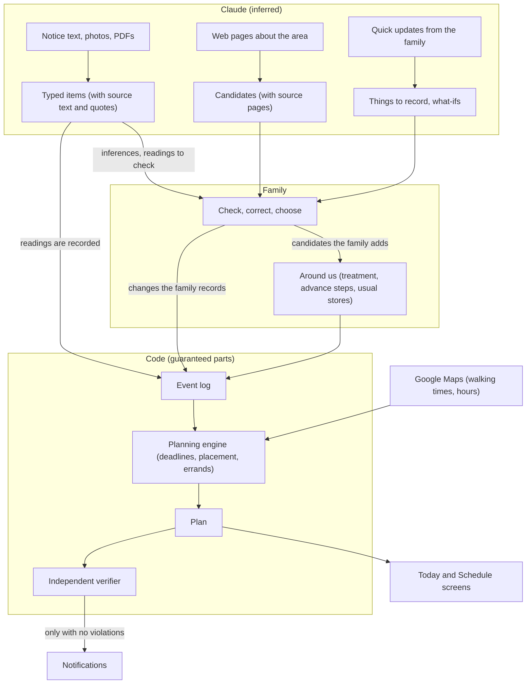

# Maniau

[日本語](README.md)

**An AI that connects the resources around you with your arrangements, so people can decide, take things on, and adapt to change while they still have a choice. It starts with dual-income families raising children.**

Some arrangements have a last moment, well before the day itself, when an option can still be chosen (its decision deadline). When several people share the work, there is also the gap between asking someone and their taking it on, waiting for replies, and tidying up after plans change. In Maniau, Claude reads scattered information and looks around the neighborhood when asked, code works out the decision deadlines and what each choice would set in motion, and a verifier written separately from the planner checks the plan. People make the choices.

The idea isn't limited to childcare. The first area is the arrangements of dual-income families raising children, built and checked with fictional family scenarios. Your family and Claude keep a shared list of what's around your home. From nursery and school notices and your everyday week, Maniau works out in code what to decide, by when, and who does it, and follows each task until someone in the family takes it on.

**Live demo: https://maniauserver-production.up.railway.app** (no sign-up; it runs on a fictional family. See the [tour of the demo](#tour-of-the-demo) below.)

Built with Claude: Japan 2026 entry

---

Putting an event in a calendar leaves the real work undone: by when each decision has to be made, whom to ask, whose reply is still pending, and how to clean up what was arranged when plans change. In a family where both parents work, one person usually carries all of this in their head.

And the math only works if you know what's around your home. Does the sick-child care room need advance registration? Which shop on the way home sells the shirt, and until what time? Which store does the family usually use? Maniau keeps these places, “around us”, together with your family and Claude, and computes decision deadlines and next steps on top of them. The family makes the choices and contacts grandparents, after-school care and others. Maniau never chooses for the family or sends those messages on its behalf.

| Compare decision deadlines | Around us | See what changes before saving |
|---|---|---|
|  |  |  |

All screens show the fictional demo family.

## Schools in Japan and working parents

When a Saturday school event turns the following weekday into a make-up school holiday, a family may need to arrange care or adjust work for that day. In a [Children and Families Agency survey](https://www.cfa.go.jp/assets/contents/node/basic_page/field_ref_resources/69799c33-85cb-44f6-8c70-08ed3a292ab5/c253a682/20251222_policies_kosodateshien_houkago-jidou_80.pdf#page=11) (as of 2025-05-01, Japanese), 1,912 of the 25,928 after-school care (gakudō) clubs open on weekdays (7.4%) stayed open until 19:01 or later. The statutory leave for caring for a child (子の看護等休暇) does not cover attending a school observation day or a sports day, though an employer may choose to include them ([Ministry of Health, Labour and Welfare Q&A](https://jsite.mhlw.go.jp/shiga-roudoukyoku/content/contents/002519187.pdf#page=5), Japanese). The maker is also a parent raising children in Japan.

## Three core ideas

### 1. Around us: kept by your family and Claude together

- **Claude looks around:** With “Look around us”, Claude uses web search to find sick-child care, temporary childcare and family support in the home's area (ward and station level), reads the pages, and suggests candidates. Only candidates whose cited sentence (a quote Claude gives as its basis) appears in the text of a page Claude read in that response, after normalizing character width and whitespace, are shown (code checks this; matching words don't prove that the sentence supports the summary or that the reading is right). Sentences taken from the page as quotes are used only for this check and are not shown or kept. Each summary is one sentence written by Claude and may contain the page's words or sentences; a summary that is a page sentence, or that contains a cited sentence, is left out when that sentence is 8 or more normalized characters. Your family opens the source page to check.
- **Your family decides:** For each candidate, your family decides whether to add it, how to treat it (usual, candidate, don't use), whether advance registration is needed, and for whom. Claude's reading is shown as a reading, with a link to the source page. Maniau never says that registration is done, that a place can be used, or that it has room.
- **Remembered, never silently replaced:** Shopping goes to the store your family picked for that item if there is one, and otherwise to a store your family marked usual, even if another store could be reached sooner. If there's no time to stop at that store, Maniau doesn't quietly move the errand elsewhere; it says why and lets your family choose. Looking around again never changes how your family treats a place.
- **It changes the math:** Options with an advance step not confirmed as done, and options that use a place marked “Don't use”, are not recommended. A newly added place can be used by copying an existing way (the old place's hours, cost and deadlines are not copied).

### 2. Decision deadlines and next steps: computed in code

- Claude reads notices (pasted text, photos, PDFs) into typed items and records which sentence each item came from.
- From the items and the household's information (people, the usual week, options and their deadlines, what's around us), code works out by when each option must be chosen. In the demo, errands on the way home use Google Maps walking times from the station to the store and the store's opening hours when map keys are set and the lookup succeeds; otherwise they use the household's estimates or are shown as not yet decidable (family households don't use map values yet).
- “If you choose this”, “What if they say no?” and “What if” (a day off, a longer meeting) are computed with the same calculation, without recording anything. When you edit household information, “What this change would do” is shown before you save.

### 3. Taken on and cleaned up: watched by a verifier

- Each task is proposed to one adult and shown as waiting to be taken on until that person accepts. Requests keep “awaiting a reply” separate from “confirmed”.
- When a postponement or cancellation arrives, preparations no longer needed are removed, and cancellation messages for people already asked are drafted (the family sends them).
- Notifications go out only when something can't wait. A verifier written separately from the planning engine checks the plan and stops notifications when it finds a violation.

## What Claude does and what code does

The model reads, looks around, infers unstated preparations, and explains. Date and time calculations, decision deadlines, where tasks go, and whether to notify are decided in code.

| | Claude (inferred) | Code (guaranteed parts) |
|---|---|---|
| Notices | Reads text, photos and PDFs into events, belongings, deadlines, conditions and changes | Checks that quotes appear in the original text and that dates match the month and day written. Inferences stay out of the plan until the family confirms them |
| Around us | Searches the web, reads pages, and suggests candidates with a reading on advance registration | Checks that the sentence Claude cites appears in the text of pages read (quotes aren't shown or kept). Nothing enters household information until the family adds it, and the family's treatment of a place is never changed |
| Quick updates | Turns a short message into something to record, a what-if, or a one-off day | Fills in a date only when it matches the date code works out from the wording. Records only when the family taps |
| Deadlines and placement | — | Working back from deadlines, fitting tasks into the usual week, stores, hours and walking times, overlaps, usual stores |
| Notifications | — | Whether something can't wait, and the independent verifier's gate |
| Suggestions | Search words for stores, ideas for ways | Nothing changes until the family checks and edits them |

Claude features used in the product:

- **Model:** The six calls (reading notices, transcribing photos and PDFs, quick updates, ideas for ways, store search words, and looking around) default to Claude Opus 5.5 (effort medium). This is set in one place, `apps/server/src/reading/model.ts`, and fast mode is switched on with an environment variable.
- **Structured outputs:** The five calls other than looking around return structured outputs with a defined schema (Zod). Looking around returns JSON in text, which is checked against a schema in the same way.
- **Image and PDF input:** Photos and PDFs of notices are read as they are. Before the call, input tokens are counted with the same request shape (count_tokens), and inputs that are too large are refused.
- **Server-side web search and page fetching:** Looking around uses web_search and web_fetch (with use limits) to find and read pages, and continues responses that pause (pause_turn). Code checks that the sentence Claude cites is in the text of a fetched page.

## How it works



- Changes the family records and readings of notices are kept as events, and the plan is always recomputed from the events. What-if calculations, and quick updates or looks around that haven't been confirmed, are not recorded as events. Plans stay linked to the original notice text or to what the family said.
- The verifier is written without importing the planning engine (a lint rule enforces this) and checks the plan independently against household information and events. What it can't check is reported as undetermined, never as “no problems”.
- Tests run without an API key (they use Claude responses recorded from fictional material). There are more than 1,800 tests across core, the verifier, the web app and the server.

### The general core and the parts for the first area

- **General core** (not split by area): the event log and sources, “things to do” with a deadline or a time window, ways with their steps and prerequisites, working back to decision deadlines, separate states for proposals, taking on, requests and replies, the differences after a change and drafts of cancellations, what-if calculations (“If you choose this”, “What if they say no?”), what's around us and how the family treats each place, the decision to notify, and the independent verifier.
- **Parts for the first area** (fitted today to dual-income families raising children): some kinds of items and ways (where a child will be, belongings, drop-off and pick-up, after-school care), the prompts for reading notices and looking around, the kinds of places looked for (sick-child care, temporary childcare, family support), family roles (adult, child, helper), Japanese holidays and time zone, and the demo family.
- From the screens, you can add to what's around us only stores and places found by looking around (not places of any other kind). Whether this works in other areas will be decided after studying each area's people, resources, deadlines and exceptions, and trying it.

## Tour of the demo

Use the scene selector at the top to move between points in time, and “Viewing as” to switch between the two adults (健太 and 彩). Each scene also shows a one-line guide at the top of the screen.

1. **11/25 Notice arrives:** A school-event notice creates child care for 陽菜 on 12/7 and a shirt to prepare. Tap “Decide” to compare each option's decision deadline and what happens if you choose it.
2. **11/26 Errand on the way home:** 彩 asked おばあちゃん and is waiting for the reply. 健太 has a task to buy the shirt at a shop on the way home. It's the store the family marked usual. On a server with map keys, when the lookup succeeds, the walking time and store hours come from Google Maps (otherwise the household's estimates are used and labeled as such).
3. **11/29 No reply yet:** The after-school care deadline is close. On 彩's screen, Maniau asks whether to hold a backup, and “What if they say no?” shows the calculation if the answer is no.
4. **11/30 Backup booked:** After-school care is held as a backup while waiting for おばあちゃん.
5. **12/4 Postponed:** Child care that is no longer needed, and the cancellations to send, split between the two adults.

The demo doesn't send notifications. Instead, on Today, the demo bar at the top shows a collapsed summary of the notification candidates at that demo time, assuming none were sent yet. Open it to read the lock-screen text, with candidates for now kept apart from those held until morning. On 11/29 the only candidate is for 彩; on 12/4 there is one for each adult. At night (from 22:00), notifications that can wait are held until 7:00 the next morning (move the clock forward to try it).

**See what's around us:** tap “Family” at the bottom, then go to “Around us”.

- “Look around us” shows what Claude found when it searched the real web once, on 2026-11-05, around the demo home (Toyosu, Koto ward), saved for the demo: for each candidate, a link to the page it read, Claude's summary, and its reading on advance registration (the full page text and separate quote fields were not saved; a summary may contain the page's words or sentences). Open “Decide how your family treats it” on a candidate, check how to treat it and the advance registration, then press “Add as a candidate for us” to see what would change before saving; you can then copy an existing way to use that place. “Ask Claude to look again now” works up to 3 times per demo and 30 times a day per server (on a server with a reading key).
- With “Edit”, you can mark each store as usual, candidate or don't use. In scene 2, setting the usual store (the clothing store near Toyosu Station) to candidate shows, before you save, that the shirt errand moves to the other (made-up) store.

To have Claude read a notice, tap “Snap” at the bottom, then “Insert a sample notice (fictional)”, then “Read it” (on a server with a reading key).

## What we've checked

These are checks on a small number of fictional cases. We don't claim a general accuracy rate, or that Maniau is better or worse than a model. Counts, costs and conditions are in the [record of how Claude is used](docs/dev/claude-usage.md) (Japanese), and comparison summaries are in [eval/results](eval/results).

- **Comparison with a strong Claude** (the evaluator fixed the cases, expected results and scoring in advance, and the person tuning prompts never saw the held-out cases): the strong Claude solved many of the cases. The checks it missed clustered around “saying so when it can't decide” and “not treating something unconfirmed as confirmed”; in one further case, all 6 of its answers somewhere stated something unchecked as a definite negative (an observation outside the scored checks). Maniau replayed the facts the family had confirmed from its records; on the 3 comparable held-out cases it met 11 of 12 checks (1 was undetermined because it wasn't checked on screen), and the verifier found no violations (the inputs differ, so this is not a like-for-like comparison). We place the difference not in “the model can't solve it” but in state that can be checked and in how later changes are handled.
- **Looking around:** The saved survey read 7 pages, produced 6 candidates and dropped none (about $0.54). The evaluation on held-out cases was too small to say Maniau is better than a general model, and is recorded that way.
- **Screens:** The main flows have been walked through at phone width (390px) in Japanese and English. A real iPhone and whether notifications actually arrive have not been checked yet.

## How we built it with Claude Code

Development centered on Claude Code, and we chose each feature for a purpose. Why we chose it, and what worked and what didn't, are in the [record of how Claude is used](docs/dev/claude-usage.md) (Japanese).

- **Subagents to research in parallel and review independently:** Before building, we researched six fields in parallel ([docs/research](docs/research)). The review before publishing, and the review of the verifier, went to subagents that weren't given the author's own conclusions; the verifier review found 7 misses and 3 false alarms, each reproduced by a test.
- **Hooks to enforce the rules mechanically:** A Claude Code PreToolUse hook stops tool use on paths outside the repository when it can detect them (a few set locations are allowed, and some forms, such as paths built from variables, can't be detected, so we don't rely on it alone). Git hooks check author emails, key-like strings, file locations and copies of private material before each commit (tests in [tests/hooks](tests/hooks)).
- **Hard-to-reverse choices: think separately, then compare:** Two agents answered the same question without seeing each other's conclusion, then compared. This moved storage from SQLite to Postgres and sign-in to Cloudflare Access, and caught that placing tasks on a 15-minute grid would drop a real 10-minute window (17:20–17:30), so placement now works to the minute.
- **Evaluation kept apart from prompt tuning:** One role fixes the cases, expected results and scoring; another tunes the product prompts and never sees the held-out cases. For Claude API calls in development and evaluation, we record the counts we could log and the costs we could determine, and say so where a cost is unknown.
- **API details from the documentation, not memory:** Using the claude-api Skill's documentation, we checked Opus 5.5's thinking, effort and structured-output limits, and found we had capped the comparison model's (a strong Claude's) output unfairly low. After a subagent read the Managed Agents documentation against the product's needs, we decided not to use it this week.
- **Screens decided with the maker on an Artifact canvas:** We laid out phone-width screens and reworked them from the maker's feedback (it looked like a professional tool; useful advice needs a location) before writing the code.

## What is sent and what is kept

- The demo's starting family and notices are fictional. Please use fictional text and photos when you try it too.
- Anthropic receives text and photos entered for reading, quick updates, and the area (ward and station level) and kinds of places to look for. What is sent and the usage limits are in [Details and limitations](docs/scope.en.md#try-your-own-text).
- Store names, opening hours and routes from Google are not kept and are not sent to Claude. Of Google's information, household information keeps only the place IDs of the linked station and the chosen store, and when they were looked up (the name your family gives the store and the item go in as your family's own entries; the proposal an adult saw when taking on a task — its times, walking minutes and the store's place ID — stays only in the demo server's memory; see [Terms and privacy](https://maniauserver-production.up.railway.app/terms.html#en)).

## What's built and what's next

Built: the three core ideas above; reading notices, photos and quick updates; things to do (what the family says, and attendance or applications a notice asks for) with a table of ways to handle them; map-based errands; and family mode (identity checks with Cloudflare Access, Postgres storage, Web Push notifications; not yet checked on a real iPhone).

Next:

- After the hackathon: once the gate before real family data is met ([foundation design](docs/design/02-foundation.md) §13.1, step 2, including checks in the real environment and on an iPhone), the maker will first use family mode at home. Asking other families to try it comes after those results.
- Regular re-checks of what's around us (for now, Maniau looks again only when the family taps).
- Using the family's usual places for recommending ways too (such as a usual sick-child care room).
- More kinds of places to look for (now sick-child care, temporary childcare and family support), and looking around for family households.
- Outside childcare, we'll look first at arranging gatherings (club activities, events, get-togethers). Not a date poll: it would connect the decision deadlines that come from a venue's application period or group registration, who takes on what after deciding, and whom to check with again after a change. People make the decisions.
  - Step by step, checking each before the next: the organizer's arrangements, then a way for participants to answer and correct their own replies, then a club's whole season.
  - Many people deciding one thing needs a new data model that holds each person's intent and who can see what. It isn't built yet (today's data model and screens assume a household).

What Maniau can't do yet, and what hasn't been checked, is listed in [Details and limitations](docs/scope.en.md#current-scope-and-limitations).

## Run it locally

You need Node.js 24 or later and pnpm 11.

```sh
pnpm install
pnpm dev
```

Open [http://localhost:5173](http://localhost:5173). The server uses port 8787. Without the family mode settings (database and Cloudflare Access), the app starts as a demo. The demo needs no API key or database. The prepared notices and the saved survey use Claude responses recorded in advance, from fictional text and from one real look around.

- With `ANTHROPIC_API_KEY` set (as an environment variable or in `.env` at the repository root), you can try reading text and photos, quick updates, ideas for ways, and looking around again with Claude. Please try it with fictional text.
- With `GOOGLE_MAPS_API_KEY` set (a server-only key allowed only for Places API (New) and Routes API), demo errands are placed with Google Maps walking times and store hours. If `GOOGLE_MAPS_BROWSER_KEY` is also set (a key allowed only for the Maps JavaScript API and restricted to the site's URL), the app shows the map.
- Fast mode: Claude is called in fast mode only when `CLAUDE_FAST_MODE=1` is set.

## Development

```sh
pnpm check
node --test eval/test/*.test.mjs
```

`pnpm check` runs formatting checks, type checks, and package tests. If you plan to commit changes, enable the repository checks once after cloning with `git config core.hooksPath scripts/git-hooks` (test the hooks themselves with `python3 -m unittest discover -s tests/hooks`).

| Path | Contents |
|---|---|
| [apps/web](apps/web) | Mobile-first interface (Japanese and English) |
| [apps/server](apps/server) | API, storage, notifications, Claude reading and looking around, maps |
| [packages/core](packages/core) | Fact types, time, and planning engine |
| [packages/verify](packages/verify) | Independent verifier (does not import the planning engine) |
| [data/demo](data/demo) | Fictional household and notices, recorded responses |
| [eval](eval) | Boundary cases and comparison tooling |

For the design, see the [model design](docs/design/01-model.md) and [foundation design](docs/design/02-foundation.md); for this week's scope, the [product plan](docs/plan/02-product.md); and for how Claude and Claude Code are used (parallel research with subagents, guard hooks, independent evaluation and more), the [record of how Claude is used](docs/dev/claude-usage.md). These documents are in Japanese.

## License

[MIT](LICENSE)
