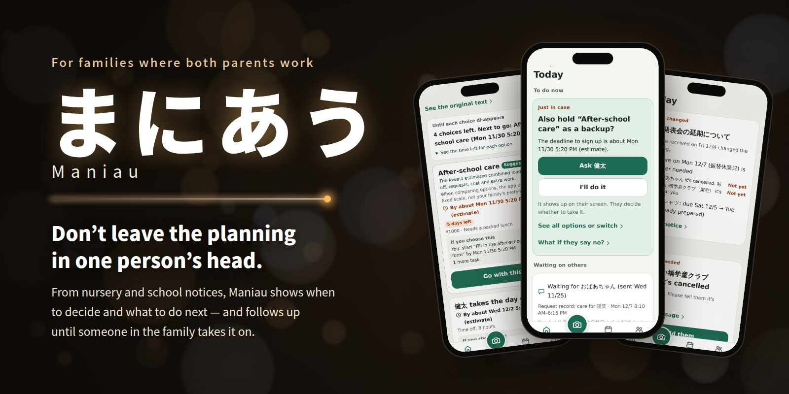
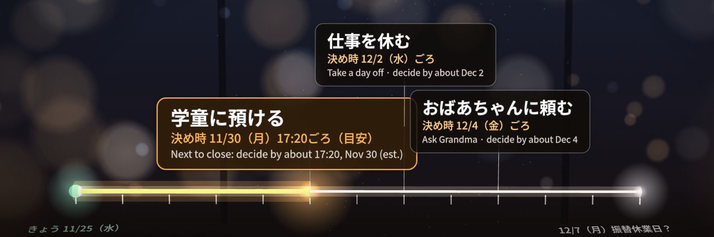
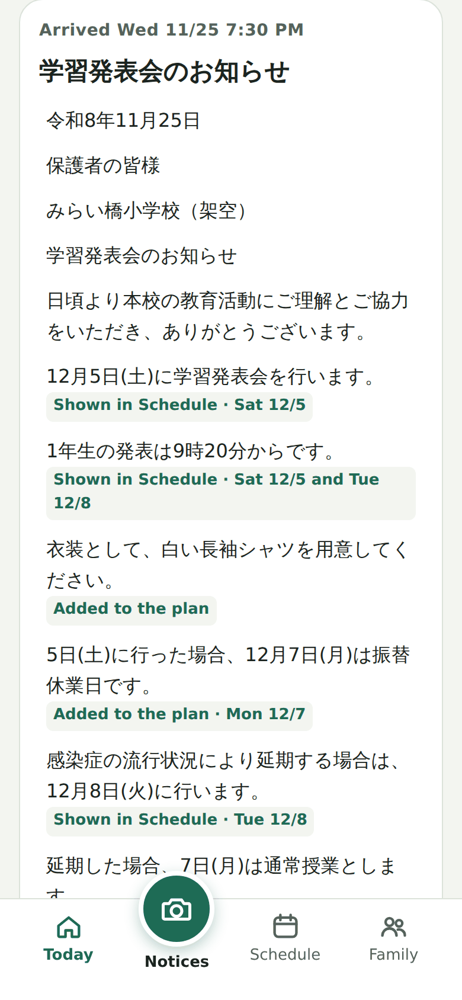
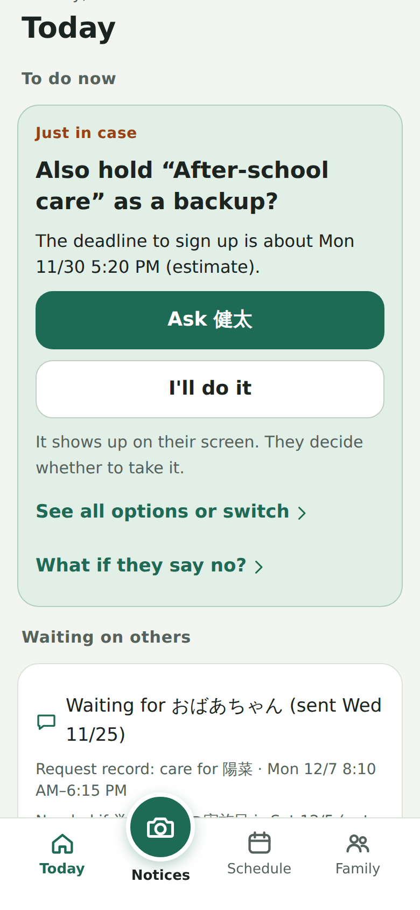
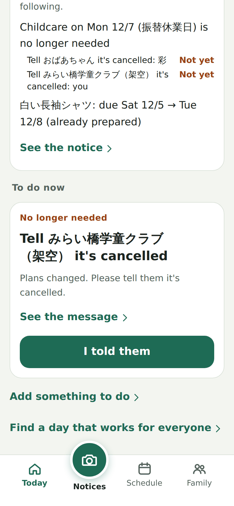
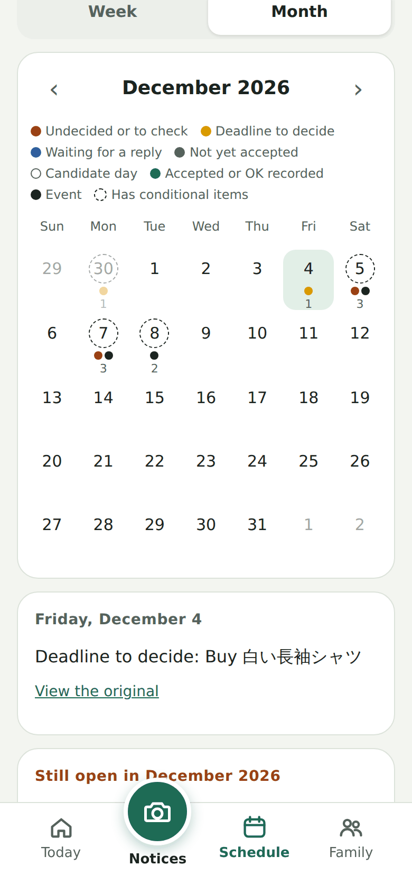
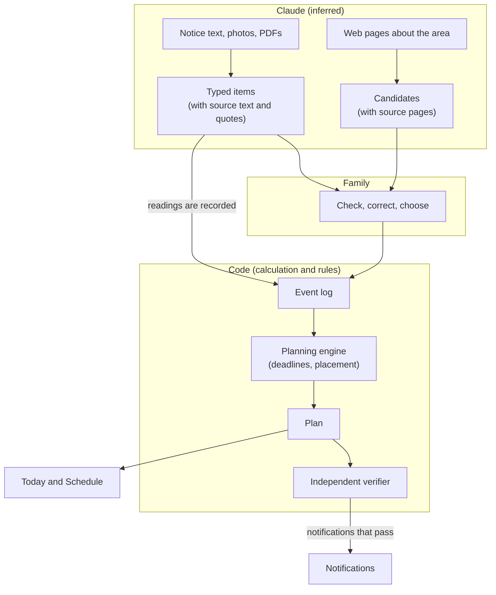

<p align="center">
  
</p>

<p align="center">
  <a href="https://maniauserver-production.up.railway.app"><b>Open the live demo</b></a>
  &nbsp;&nbsp;·&nbsp;&nbsp;
  <a href="#see-it-in-3-minutes">See it in 3 minutes</a>
  &nbsp;&nbsp;·&nbsp;&nbsp;
  <a href="README.md">日本語</a>
</p>

<p align="center"><sub>Built with Claude: Japan 2026 entry · No sign-up; runs on a fictional family · MIT</sub></p>

<br>

## The event is on the calendar. The planning isn’t done.

When a notice arrives from nursery or school, putting the event in a calendar doesn’t finish the job. By when does each decision have to be made? Whom do we ask? Has anyone replied? If plans change, how do we undo what we arranged? In a family where both parents work, one person can end up carrying much of that planning alone.

**Maniau** (まにあう, “to make it in time”) is an AI that helps a family share that planning. While there are still choices, it shows where things will stop working out and what to do next, and it follows up until someone in the family takes it on. The family chooses how to cover care and sends the messages.

| | Schools in Japan and working parents |
|:--|:--|
| **7.4%** | Of the 25,928 after-school care (gakudō) clubs open on weekdays, 1,912 stay open until 19:01 or later ([Children and Families Agency survey](https://www.cfa.go.jp/assets/contents/node/basic_page/field_ref_resources/69799c33-85cb-44f6-8c70-08ed3a292ab5/c253a682/20251222_policies_kosodateshien_houkago-jidou_80.pdf#page=11), as of 2025-05-01, Japanese) |
| **Not covered** | The statutory leave for caring for a child (子の看護等休暇) does not cover attending a school observation day or a sports day, though an employer may choose to include them ([Ministry of Health, Labour and Welfare Q&A](https://jsite.mhlw.go.jp/shiga-roudoukyoku/content/contents/002519187.pdf#page=5), Japanese) |
| **Make-up holidays** | When a Saturday school event turns the following weekday into a school holiday, a family may need to arrange care or adjust work for that day |

The maker is also a parent raising children in Japan.

<br>

## What Maniau does

<p align="center"></p>

For options it can calculate, Maniau estimates the last time to decide (the decision deadline) from the household’s information. It shows which option closes next and what to decide by then, and follows up until someone takes it on.

| ① Read | ② Compare deadlines | ③ Follow up | ④ Clean up after a change |
|:-:|:-:|:-:|:-:|
|  |  |  |  |
| Claude reads the notice; each sentence keeps a note of how it was used | Code shows estimated decision times and the tasks each choice would start when they can be calculated, and says when it can’t determine them | If no reply is recorded and another option’s decision time approaches, Maniau asks whether to hold a backup | It shows what is no longer needed and whom to tell it’s cancelled |

<br>

## For example: one notice, two weeks

健太 (Kenta) and 彩 (Aya) both work, and their child 陽菜 (Hina) is in first grade. (A fictional family. The notice readings were recorded earlier; nothing is sent to Claude when you open the demo.)

| Day | What happens | What Maniau does |
|:--|:--|:--|
| **Wed 11/25** | A school-event notice: 「5日(土)に行った場合、12月7日(月)は振替休業日です」 (if the event is held on Sat the 5th, Mon Dec 7 is a make-up school holiday) and 「白い長袖シャツを用意してください」 (please prepare a white long-sleeved shirt) | Shows that someone needs to look after 陽菜 on 12/7 (if the event is on the 5th) and that a shirt is needed, keeping which sentence each item came from |
| | Comparing care options | For each option, shows the last moment it can still be chosen: after-school care by the evening of Mon 11/30, 健太 or 彩 taking the day off by the evening of Wed 12/2, asking おばあちゃん (grandma) by the night of Fri 12/4 (all estimates), and what each choice would set in motion. If the family says the shirt is not at home, Maniau proposes an errand for 健太 on the way home, at the store the family marked as usual |
| | 彩 asks grandma | Maniau drafts the message; 彩 sends it and records that it was sent |
| **Sun 11/29** | No reply recorded yet | The after-school care deadline is the next day, so Maniau asks 彩 whether to hold it as a backup too |
| **Mon 11/30** | After-school care booked as a backup | In this example, 健太, who already took on the backup, applies and records it |
| **Fri 12/4** | A postponement notice | Care on 12/7 is no longer needed; whoever asked grandma and whoever applied to after-school care each get a task to tell them it’s cancelled (with a draft message) |

The same mechanism can settle a date from candidate days and people’s answers, like a club practice day (a fictional example).

<br>

## What makes it different

**1. Code computes the deadlines.**
Claude reads and researches; code works out dates, decision deadlines and when each task fits. You can trace “why by this day” back to the original sentence and the family’s usual week.

**2. It follows through: until someone takes it on, and after plans change.**
Who took a task on, whether a reply was recorded, and whom to tell what after plans change all stay in the plan.

**3. It knows what’s around your home, kept by your family and Claude together.**
Claude searches the web for sick-child care, temporary childcare and family support in your area and offers candidates, citing the pages it read. The family decides which to add, whether advance registration is needed, and which store is the usual one; Maniau remembers this and uses it in its calculations. It never changes the family’s choices on its own.

**4. A separately written verifier checks before anything is sent.**
A verifier written separately from the planning engine checks the plan and the notifications; when it finds a violation, it holds back the affected notifications, or all of them when it can’t narrow the scope. Where it can’t check something, it reports it as undetermined, never as “no problems”.

**5. The family chooses, and the family sends.**
Deciding how to cover care or which day to pick, and sending requests or cancellations, are up to the family. What Maniau infers from a notice is labeled as an inference and isn’t turned into tasks as if it were certain until the family confirms it.

| Around us | See what changes before saving | Month view |
|:-:|:-:|:-:|
|  |  |  |
| Whether advance registration is done is entered by the family; research alone never marks it done | When you edit household information, “What this change would do” is shown before you save | Undecided items, decision deadlines and pending replies are marked, and days that depend on a condition are circled with a dotted line |

<sub>All screens show the fictional demo family.</sub>

<br>

## How it works



- Changes the family records and readings of notices are kept as events, and the plan is always recomputed from the events. Plans stay linked to the original notice text or to what the family said.
- The verifier is written without importing the planning engine (a lint rule enforces this) and checks the plan independently against household information and events.
- Tests run without an API key (they use Claude responses recorded from fictional material).

<details>
<summary><b>What Claude does and what code does</b> (table)</summary>

<br>

The model reads, looks around, infers unstated preparations, and explains. Date and time calculations, decision deadlines, where tasks go, and whether to notify are decided in code.

| | Claude (inferred) | Code (calculation and rules) |
|---|---|---|
| Notices | Reads text, photos and PDFs into events, belongings, deadlines, conditions and changes | Checks that quotes appear in the original text and that dates match the month and day written. Inferences aren’t turned into tasks as if they were certain until the family confirms them |
| Around us | Searches the web, reads pages, and suggests candidates with a reading on advance registration | Checks that the sentence Claude cites appears in the text of pages read (quotes aren't shown or kept). Nothing enters household information until the family adds it, and the family's treatment of a place is never changed |
| Quick updates | Turns a short message into something to record, a what-if, or a one-off day | Fills in a date only when it matches the date code works out from the wording. Records only when the family taps |
| Deadlines and placement | — | Working back from deadlines, fitting tasks into the usual week, stores, hours and walking times, overlaps, usual stores |
| Notifications | — | Rules for whether to notify (a decision deadline is near, someone was asked to take on a task, and so on), and the independent verifier's gate |
| Suggestions | Search words for stores, ideas for ways | Nothing changes until the family checks and edits them |

</details>

<br>

## Where it’s headed

- **This version:** in a fictional trial, you can follow a one-child family’s decision deadlines, requests, replies and cleanup after a change, and compare the two adults’ screens.
- **Next:** families with two or more children (the family confirms which child each notice is for, and care, drop-offs and pick-ups, and things to bring are worked out for each child), and letting a family create its own household with both adults joining from their own phones. The maker will first use family mode at home, and other families will be asked to try it after those results.
- **Beyond:** the core — the event log, decision deadlines, taking on, and verification — is written so that it does not depend on one area. We also tried a fictional example of choosing a child’s club practice day from the answers of the people involved. Whether it works beyond childcare will be decided after studying that area’s people, resources, deadlines and exceptions, and trying it. People make the decisions.

<br>

## What works in this version

- Reading notices (pasted text, photos, PDFs) and quick updates from the family. Plans link back to the original text, and a misread date or an event’s time or name can be corrected on the notice screen.
- Comparing each option’s decision deadline. “If you choose this”, “What if they say no?” and “What if” are computed with the same calculation, without recording anything.
- Proposing tasks to either adult and taking them on, drafting requests, recording replies, and prompting a check when no reply has been recorded.
- When plans change: removing preparations no longer needed and drafting cancellation messages.
- Around us: Claude looking around, the family deciding how to treat each place and whether advance registration is done, errands at the usual store, and the family map (in trials when map keys and lookups are available; not yet in family mode).
- Things to do and ways to handle them, choosing a day from candidate days and answers, a Schedule with week and month views, and exporting only settled items to a phone calendar as an .ics file (a one-time copy, not automatic sync).
- Screens in Japanese and English.

**Not yet:** families with two or more children. For a closure over several days, the days between may be left out of the plan. Places added from looking around don’t yet become child-care options (asking someone, after-school care, taking the day off). Whether family-mode notifications reach a real iPhone hasn’t been tested. See “What this version covers” below and [Details and limitations](docs/scope.en.md#current-scope-and-limitations).

<br>

## See it in 3 minutes

1. Open the [live demo](https://maniauserver-production.up.railway.app) and press “View prepared scenes (for judges)” on the first screen (no sign-up). The app opens in Japanese; tap “English” at the top to switch.
2. Switch “Scene” at the top from **11/25 → 11/29 → 12/4**. Use “Viewing as” to compare the two adults’ screens (健太 and 彩).
3. On 11/25, tap “Choose how to arrange care” to compare each option’s deadline; on 11/29, see the backup question on 彩’s screen; on 12/4, see “No longer needed”.

Other ways to try it (your own family, the sample family, choosing a day) are in “Tour of the demo” below.

<br>

## Claude and Claude Code

**In the product:** the six calls — reading notices, transcribing photos and PDFs, quick updates, ideas for ways, store search words, and looking around — default to Claude Opus 5.5. Five return structured outputs with a defined schema (Zod); looking around uses server-side web_search and web_fetch to find and read pages. Code checks that the sentence Claude cites is in the text of a page it read.

**In development:** we built Maniau mainly with Claude Code.

- **Subagents** researched six fields in parallel before building, and reviewed the verifier without being given the author’s own conclusions, finding 7 misses and 3 false alarms, each reproduced by a test.
- **Hooks** stop tool use on out-of-scope paths, such as those under the home directory, when they can detect them (some forms can’t be detected, so we don’t rely on them alone), and check for key-like strings and copies of private material before each commit.
- **The claude-api Skill’s documentation** was used to check Opus 5.5’s thinking, effort and structured-output limits, and we found we had capped the comparison model’s (a strong Claude on its own) output unfairly low.
- **Evaluation was kept apart from prompt tuning**; the person tuning prompts never saw the held-out cases.

Why we chose each, and what worked and what didn’t, are in the [record of how Claude is used](docs/dev/claude-usage.md) (Japanese).

<details>
<summary><b>Claude features used in the product</b></summary>

<br>

- **Model:** The six calls (reading notices, transcribing photos and PDFs, quick updates, ideas for ways, store search words, and looking around) default to Claude Opus 5.5 (effort medium). This is set in one place, `apps/server/src/reading/model.ts`, and fast mode is switched on with an environment variable.
- **Structured outputs:** The five calls other than looking around return structured outputs with a defined schema (Zod). Looking around returns JSON in text, which is checked against a schema in the same way.
- **Image and PDF input:** Photos and PDFs of notices are read as they are. Before the call, input tokens are counted with the same request shape (count_tokens), and inputs that are too large are refused.
- **Server-side web search and page fetching:** Looking around uses web_search and web_fetch (with use limits) to find and read pages, and continues responses that pause (pause_turn). Code checks that the sentence Claude cites is in the text of a fetched page.

</details>

<details>
<summary><b>How we used Claude Code in development</b> (table and details)</summary>

<br>

| Feature or practice | Purpose | Evidence |
|---|---|---|
| `claude-api` Skill | Check the API's thinking and output limits and correct the comparison model's output limit | [Usage record](docs/dev/claude-usage.md) · [Comparison runner](eval/run-baseline.mjs) |
| PreToolUse hook | Stop detectable out-of-scope paths under the home directory and `/mnt`, with permitted exceptions | [Settings](.claude/settings.json) · [Hook](.claude/hooks/guard-paths.py) · [Tests](tests/hooks/test_hooks.py) |
| Git pre-commit hook | Check for key-like strings and copies of private material before publication | [Hook](scripts/git-hooks/pre-commit) · [Tests](tests/hooks/test_hooks.py) |
| Independent subagent review | Look for verifier misses and false positives with a reviewer separate from the implementer | [Usage record](docs/dev/claude-usage.md) · [Verifier tests](packages/verify/test/plan.test.ts) |
| Subagent in an isolated worktree | Fix the reference date for “tomorrow” alongside screen work; review the patch before integrating it | [Usage record](docs/dev/claude-usage.md) · [Date handling](packages/core/src/reading/output.ts) |
| Separate evaluation role | Fix scenarios and scoring first, keeping held-out scenarios from the person adjusting the prompt | [Evaluation method and results](eval/results/g2-summary-20261104.md) |

- **Subagents to research in parallel and review independently:** Before building, we researched six fields in parallel ([docs/research](docs/research)). The review before publishing, and the review of the verifier, went to subagents that weren't given the author's own conclusions; the verifier review found 7 misses and 3 false alarms, each reproduced by a test.
- **Hooks to enforce the rules mechanically:** A Claude Code PreToolUse hook stops tool use on paths outside the repository when it can detect them (a few set locations are allowed, and some forms, such as paths built from variables, can't be detected, so we don't rely on it alone). Git hooks check author emails, key-like strings, file locations and copies of private material before each commit (tests in [tests/hooks](tests/hooks)).
- **Hard-to-reverse choices: think separately, then compare:** Two agents answered the same question without seeing each other's conclusion, then compared. This moved storage from SQLite to Postgres and sign-in to Cloudflare Access, and caught that placing tasks on a 15-minute grid would drop a real 10-minute window (17:20–17:30), so placement now works to the minute.
- **Evaluation kept apart from prompt tuning:** One role fixes the cases, expected results and scoring; another tunes the product prompts and never sees the held-out cases. For Claude API calls in development and evaluation, we record the counts we could log and the costs we could determine, and say so where a cost is unknown.
- **API details from the documentation, not memory:** Using the claude-api Skill's documentation, we checked Opus 5.5's thinking, effort and structured-output limits, and found we had capped the comparison model's (a strong Claude's) output unfairly low. After a subagent read the Managed Agents documentation against the product's needs, we decided not to use it this week.
- **Screens decided with the maker on an Artifact canvas:** We laid out phone-width screens and reworked them from the maker's feedback (it looked like a professional tool; useful advice needs a location) before writing the code.

</details>

<br>

## What we’ve checked

These are checks on a small number of fictional cases. We don't claim a general accuracy rate, or that Maniau is better or worse than a model. Counts, costs and conditions are in the [record of how Claude is used](docs/dev/claude-usage.md) (Japanese), and comparison summaries are in [eval/results](eval/results).

- **Comparison with a strong Claude:** the strong Claude solved many of the cases. The checks it missed clustered around “saying so when it can't decide” and “not treating something unconfirmed as confirmed”. We place the difference not in “the model can't solve it” but in state that can be checked and in how later changes are handled.
- **Tests:** run without an API key. On 2026-11-08, on `1fc525c`, `pnpm check` passed 2,650 tests and the browser end-to-end tests (`pnpm e2e`) passed 39.
- **Screens:** the main flows have been walked through at phone width (390px) in Japanese and English. A real iPhone and whether notifications actually arrive have not been checked yet.

<details>
<summary><b>What we’ve checked, in detail</b></summary>

<br>

- **Comparison with a strong Claude** (the evaluator fixed the cases, expected results and scoring in advance, and the person tuning prompts never saw the held-out cases): the strong Claude solved many of the cases. The checks it missed clustered around “saying so when it can't decide” and “not treating something unconfirmed as confirmed”; in one further case, all 6 of its answers somewhere stated something unchecked as a definite negative (an observation outside the scored checks). Maniau replayed the facts the family had confirmed from its records; on the 3 comparable held-out cases it met 11 of 12 checks (1 was undetermined because it wasn't checked on screen), and the verifier found no violations (the inputs differ, so this is not a like-for-like comparison). We place the difference not in “the model can't solve it” but in state that can be checked and in how later changes are handled.
- **Looking around:** The saved survey read 7 pages, produced 6 candidates and dropped none (about $0.54). The evaluation on held-out cases was too small to say Maniau is better than a general model, and is recorded that way.
- **Looking around from where you live:** We ran it once end to end with the real map and Claude, using a public building's address (a ward office). The map returned a spot to check, and the survey produced 7 candidates (from the ward's and the social welfare council's pages; about $0.51, on the version before the city hint was removed). Searching the map by a candidate's name sometimes brought up other facilities (one sick-child care room's name returned three other rooms nearby), so the walk from home is shown only after your family picks the same place.
- **Tests:** On 2026-11-08, `pnpm check` passed 2,650 tests on `1fc525c`: core 495, verifier 747, web 681 and server 727. The browser end-to-end tests (`pnpm e2e`) passed 39 on the same version.
- **Screens:** The main flows have been walked through at phone width (390px) in Japanese and English. A real iPhone and whether notifications actually arrive have not been checked yet.

</details>

<br>

## More details

<details>
<summary><b>The three core ideas in detail</b> (around us, deadlines and next steps, taking on and cleaning up)</summary>

### 1. Around us: kept by your family and Claude together

- **Claude looks around:** With “Look around us”, Claude uses web search to find sick-child care, temporary childcare and family support in the home's area (ward and station for the sample family; down to the town the family entered in the names-only trial), reads the pages, and suggests candidates. Only candidates whose cited sentence (a quote Claude gives as its basis) appears in the text of a page Claude read in that response, after normalizing character width and whitespace, are shown (code checks this; matching words don't prove that the sentence supports the summary or that the reading is right). Sentences taken from the page as quotes are used only for this check and are not shown or kept. Each summary is one sentence written by Claude and may contain the page's words or sentences; a summary that is a page sentence, or that contains a cited sentence, is left out when that sentence is 8 or more normalized characters. Your family opens the source page to check.
- **From where you live to the walk from home:** In the names-only trial, you set where you live in two fields. The area field (prefecture, city or ward, and town) is kept in your household and sent to Claude when looking around. The block and house number field is used, together with the area, only to find the spot on the map (Google), and is not kept. Only when your family confirms the spot the map found does the trial keep a place ID that points to it. For each candidate found, Maniau searches the map near home using the candidate's name; once your family compares with the address on the source page and picks the same place, it shows the walk from home (other facilities also come up, so your family picks; names, addresses and walking times from the map are not kept).
- **Your family's map:** In the trial, you can search for home, school, shops and other places, check their addresses and link the ones your family chooses to the map. Places without a confirmed location stay in the list; their positions are not guessed. You can also link a place from a survey after checking it is the same one. Adding a place alone does not add it to the usual schedule or child-care options.
- **Your family decides:** For each candidate, your family decides whether to add it, how to treat it (usual, candidate, don't use), whether advance registration is needed, and for whom. Claude's reading is shown as a reading, with a link to the source page. Maniau never says that registration is done, that a place can be used, or that it has room.
- **Remembered, never silently replaced:** Shopping goes to the store your family picked for that item if there is one, and otherwise to a store your family marked usual, even if another store could be reached sooner. If there's no time to stop at that store, Maniau doesn't quietly move the errand elsewhere; it says why and lets your family choose. Looking around again never changes how your family treats a place.
- **It changes the math:** Options with an advance step not confirmed as done, and options that use a place marked “Don't use”, are not recommended. A newly added place can be used by copying an existing way (the old place's hours, cost and deadlines are not copied).

### 2. Decision deadlines and next steps: computed in code

- Claude reads notices (pasted text, photos, PDFs) into typed items and records which sentence each item came from.
- From the items and the household's information (people, the usual week, options and their deadlines, what's around us), code works out by when each option must be chosen. In the demo, errands on the way home use Google Maps walking times from the station to the store and the store's opening hours when map keys are set and the lookup succeeds; otherwise they use the household's estimates or are shown as not yet decidable (family households don't use map values yet).
- “If you choose this”, “What if they say no?” and “What if” (a day off, a longer meeting) are computed with the same calculation, without recording anything. When you edit household information, “What this change would do” is shown before you save.

### 3. Taken on and cleaned up: watched by a verifier

- Each task is proposed to one adult and shown as waiting to be taken on until that person accepts. Requests keep “awaiting a reply” separate from “confirmed”. While a child-care request, or a request for a “thing to do” with set times, has no reply recorded, it moves to the requester’s “To do now” as a prompt to check from 26 hours before the requested time (not when a child-care backup is already secured, for example; a “thing to do” with only a deadline is not raised, because no reply deadline is defined for it).
- When a postponement or cancellation arrives, preparations no longer needed are removed, and cancellation messages for people already asked are drafted (the family sends them).
- Notifications go out only when a rule calls for one: for example, when a decision deadline is near, when another adult asks you to take on a task, or when a “thing to do” read from a notice remains unchecked for an hour after the reading (the notification goes to the person who added the notice). At night, anything that can wait until morning is held. Before sending, a verifier written separately from the planning engine checks the plan and the notifications, and stops them when it finds a violation.

### The general core and the parts for the first area

- **General core** (not split by area): the event log and sources, “things to do” with a deadline or a time window, ways with their steps and prerequisites, working back to decision deadlines, separate states for proposals, taking on, requests and replies, the differences after a change and drafts of cancellations, what-if calculations (“If you choose this”, “What if they say no?”), candidate days and answers (who answers, where each answer came from, the counts, and a record of what the decision was based on), what's around us and how the family treats each place, the decision to notify, and the independent verifier.
- **Parts for the first area** (fitted today to dual-income families raising children): some kinds of items and ways (where a child will be, belongings, drop-off and pick-up, after-school care), the prompts for reading notices and looking around, the kinds of places looked for (sick-child care, temporary childcare, family support), family roles (adult, child, helper), Japanese holidays and time zone, and the demo family.
- From the screens, you can add to what's around us only stores and places found by looking around (not places of any other kind). Whether this works in other areas will be decided after studying each area's people, resources, deadlines and exceptions, and trying it.

</details>

<details>
<summary><b>Tour of the demo</b> (from the start, the sample family, prepared scenes, around us)</summary>

### Try it from the start

1. Press “Start” and enter made-up nicknames for the adults and one child. The trial supports one child for now.
2. Add the example notice with “Try an example”. It uses a prepared reading; nothing is sent to Claude for this example. **Example summary (written for this demo):** A Dec 5 school event may move to Dec 8. If held on Dec 5, Dec 7 is a school holiday. A white long-sleeved shirt is needed.
3. When asked about child care, enter what you know, see what changes, and then save. You can leave times you do not know as unknown. To try steps 4–6, as a made-up example, set “Usual weekday (Mon–Fri)” to “Goes to work” and the day to “As usual” for each adult, then save (no arrangement appears for times you say someone can watch the child).
4. On the decision screen, use “Add a way to cover the day” to add a person to ask and a deadline (you can also add a full day at after-school care, or an adult taking the day off, with the deadlines you choose; then compare the decision deadline of each way you added). Choose a way and review the message. Your family sends the message. After sending, press “Record that I sent it”; Today then shows the request under “Waiting on others”. Your family also records the reply, for example with “They said OK”.
5. Without recording a reply, open “Controls” and use “+1 day” and “+1 hour” to move the clock into the 26 hours before the requested time starts. The person who sent the request gets a card under “To do now” to check on the reply, and this trial’s notification list shows it too. It goes away when you press “They said OK”.
6. Once the trial clock is at Dec 4, 17:52 or later (it already is if you followed step 5), press “Add the example’s follow-up: 学習発表会の延期について (made up)” in “Controls” (it uses a prepared reading; nothing is sent to Claude). Child care on Dec 7 in this example is no longer needed, so the person who recorded asking for it gets “No longer needed” under “To do now”. Press “See the message” to see the message telling them it is cancelled; after telling them, press “I told them”, and it goes away.
7. Open the “Family” tab at the bottom and set where you live in “Around us”. Keep family details other than the address made up; the address can be a real one (if you’d rather not use your own home, a nearby station or public building works too). If the spot the map found is right, press “This spot is right”, then “Look around us” to have Claude look now (about a minute; up to 3 times per trial and 30 times per server process per day [UTC], on a server with a reading key). On a candidate, “Check the walk from home on the map” lets you pick the same place and then shows the walk from home (on a server with a map key).

In the names-only trial, the household settings take nicknames for the adults and the child, the usual week, people you can ask and where you live, among other things (you can also add notices and things to do). To cover child care, you can add three kinds of ways: asking someone, a full day at after-school care, and an adult taking the day off (your family enters the deadlines, plus the program’s fee and hours for the day; time off by the hour can’t be added yet). A way that covers only part of the needed time (the program’s hours are shorter, or the adult taking the day off has busy time that day) shows the uncovered times and can’t be chosen. A way that can no longer be used can be marked as unusable (add it again when it can be used). You can also choose the child's drop-off and pick-up rule for lessons and clubs (to, from). A thing to do can be added with just what, by when and who. “Find a day that works for everyone” on Today lets you offer candidate days, record answers and settle the day (before anyone is asked or takes it on, you can change the candidate days). Stations and the way home for shopping cannot be added, so buying on the way home is shown with the sample family (it starts as a separate trial; what you have entered here does not carry over).

The trial clock is separate from the current date and time. The trial is kept in server memory and expires after a period of inactivity. Reading a made-up notice you write sends the text to Claude, on a server where reading is available.

### Try the sample family

On the first screen, press “Try the sample family” to start with a family that already has weekly routines, after-school care, a person to ask (grandma) and leave for both adults. Add the example notice with “Try an example”, then press “Choose how to arrange care” to compare the deadlines of the four ways and which one goes next.

### View prepared scenes

On the first screen, press “View prepared scenes (for judges)”. Use the scene selector at the top to move between points in time, and “Viewing as” to switch between the two adults (健太 and 彩). Each scene also shows a one-line guide at the top of the screen.

1. **11/25 Notice arrives:** A school-event notice creates child care for 陽菜 on 12/7 and a shirt to prepare. Tap “Choose how to arrange care” to compare each option's decision deadline and what happens if you choose it.
2. **11/26 Errand on the way home:** 彩 asked おばあちゃん and is waiting for the reply. 健太 has a task to buy the shirt at a shop on the way home. It's the store the family marked usual. On a server with map keys, when the lookup succeeds, the walking time and store hours come from Google Maps (otherwise the household's estimates are used and labeled as such).
3. **11/29 No reply yet:** The after-school care deadline is close. On 彩's screen, Maniau asks whether to hold a backup, and “What if they say no?” shows the calculation if the answer is no.
4. **11/30 Backup booked:** After-school care is held as a backup while waiting for おばあちゃん.
5. **12/4 Postponed:** Child care that is no longer needed, and the cancellations to send, split between the two adults.
6. **12/5 Choose a day for a sitter:**
   1. Open “陽菜を見てもらう” on Today and see the answers from おばあちゃん and 近所のサトウさん.
   2. Use “Make a new link” for 近所のサトウさん and open it in another tab or browser.
   3. On the answer page, answer “Yes” for 12/13, then return to the family screen and press “Load the latest answers (from other screens or links)”.
   4. Open “See what changes if you choose this day” for 12/13, press “Choose this day”, then “See the arrangement for this day”.
7. **12/6 Choose a practice day:**
   1. Open “クラブの練習” on Today and see that at least six “yes” answers and the coach's “yes” are needed.
   2. Use “Make a new link” for コーチ, open it in another tab or browser, and answer “Yes” for 12/19.
   3. On the family screen, press “Load the latest answers (from other screens or links)” and compare the answers and whose answers can change it.
   4. Open “See what changes if you choose this day” for 12/19, choose the day, then open “See the arrangement for this day” to see the gym arrangement.
8. **12/6 Busy time:** 健太 recorded busy time on 12/19, 9:30–10:30 (an online meeting at home). The 12/19 practice candidate now shows an “overlaps” line (answers and counts stay as they are). Open that day from the list in Family and remove it, and the line goes away. It also changes where tasks go: in the “11/26 Errand on the way home” scene, add 18:30–19:30 on 11/26 for 健太 and look — the shirt purchase moves to 11/27.

Answer links work only in demo households. Anyone holding a link can answer; the holder's identity is not checked. Meeting the answer and number requirements does not confirm that the venue has room. To change the day after someone has been asked or taken on a task, mark the “thing to do” as not needed and add it again.

The demo doesn't send notifications. Instead, on Today, the demo bar at the top shows a collapsed summary of the notification candidates at that demo time, assuming none were sent yet. Open it to read the lock-screen text, with candidates for now kept apart from those held until morning. On 11/29 the only candidate is for 彩; on 12/4 there is one for each adult. At night (from 22:00), notifications that can wait are held until 7:00 the next morning (move the clock forward to try it).

**See what's around us:** tap “Family” at the bottom, then go to “Around us”.

- “Look around us” shows what Claude found when it searched the real web once, on 2026-11-05, around the demo home (Toyosu, Koto ward), saved for the demo: for each candidate, a link to the page it read, Claude's summary, and its reading on advance registration (the full page text and separate quote fields were not saved; a summary may contain the page's words or sentences). Open “Decide how your family treats it” on a candidate, check how to treat it and the advance registration, then press “Add as a candidate for us” to see what would change before saving; you can then copy an existing way to use that place. “Ask Claude to look again now” works up to 3 times per demo and 30 times a day per server (on a server with a reading key).
- With “Edit resources”, you can mark each store as usual, candidate or don't use. In scene 2, setting the usual store (the clothing store near Toyosu Station) to candidate shows, before you save, that the shirt errand moves to the other (made-up) store.

To have Claude read a notice, tap “Notices” at the bottom, then “Insert a sample notice (fictional)”, then “Read it” (on a server with a reading key).

</details>

<details>
<summary><b>What this version covers</b></summary>

<br>

- It is for families with one child (the names-only trial takes one child, and the sample family and prepared scenes have one child).
- For a closure over several days, reading may capture only the first and last dates, leaving the days between out of the plan. Check each day and add the arrangements you need individually.
- The public demo and the names-only trial let you move the clock apart from the real date and time. Records are kept in server memory and are deleted after a period without use.
- There is not yet a self-service way for a family to set up a long-term household and have both adults join it from their own phones. Family mode (identity checks, storage and notifications) is turned on by someone who sets it up, and it hasn't been checked in a real family's daily life; whether notifications reach a real iPhone hasn't been tested.
- Places added from looking around can be used in household information and in ways to handle things to do, but they don't yet become child-care options (asking someone, after-school care, taking the day off).
- Searching for and linking places on the family map is available in the public demo and the names-only trial when map keys are configured and lookups succeed; it is not available in family mode yet.

What works and what doesn't is described in [details and limitations](docs/scope.en.md#current-scope-and-limitations).

</details>

<details>
<summary><b>What’s built and what’s next</b></summary>

<br>

Built: the three core ideas above; reading notices, photos and quick updates; things to do (what the family says, and attendance or applications a notice asks for) with a table of ways to handle them; choosing the day from candidate days and answers (started from Today, with candidate days editable before anyone is asked or takes it on; per-person answer links work only in demo households); a Schedule with week and month views (the month grid marks undecided items, decision deadlines, pending replies and who has taken things on, circles days that depend on a condition with a dotted line, and shows each day’s lines, including things to bring or submit; plus who has taken on each task, the reply recorded for each request, tasks without a set time, and links back to the original text); exporting only settled items to a phone calendar as an .ics file (a one-time copy); map-based errands; taking out a whole notice added by mistake; correcting a misread date or an event’s time or name, or taking one item out of the plan, on the notice screen; counting “tomorrow” and “today” from the day a notice was written (if that day isn’t chosen, the date is treated as an estimate for the family to check); asking again after a request's day or time changes (including asking to change the time on the same day); and family mode (identity checks with Cloudflare Access, Postgres storage, Web Push notifications; not yet checked on a real iPhone).

Next:

- Families with two or more children: the family confirms which child each notice is for, and child care, drop-offs and pick-ups, and things to bring are worked out for each child. This comes first after the hackathon.
- Letting a family create its own household and both adults join from their own phones (family-mode households are set up by the operator for now).
- After the hackathon: once the gate before real family data is met ([foundation design](docs/design/02-foundation.md) §13.1, step 2, including checks in the real environment and on an iPhone), the maker will first use family mode at home. Asking other families to try it comes after those results.
- Regular re-checks of what's around us (for now, Maniau looks again only when the family taps).
- Using the family's usual places for recommending ways too (such as a usual sick-child care room).
- More kinds of places to look for (now sick-child care, temporary childcare and family support), and looking around for family households.
- You can try arranging a fictional club practice for the child with the same “thing to do”, candidate days and answers. Whether it works for real gatherings or beyond childcare needs checking with that area's people, resources, deadlines and exceptions. People make the decisions.
  - Choosing different ways for each candidate, changing the day after asking someone or a task is taken on, and answer links in family mode are not available yet. Arranging a club's whole season is also future work.

</details>

<details>
<summary><b>What is sent and what is kept</b></summary>

<br>

- The demo's starting family and notices are fictional. Please use fictional text, photos and PDFs when you try it too. Only where you live, in the names-only trial, can be a real address.
- Anthropic receives text, photos and PDFs entered for reading, quick updates, and the area (ward and station for the sample family; in the names-only trial, the text the family typed in the area field) and kinds of places to look for. The block and house number field is not sent (the area field is sent with spaces removed). What is sent and the usage limits are in [Details and limitations](docs/scope.en.md#try-your-own-text).
- The address entered in the names-only trial (the area field and the block and house number field) is sent to Google only to find the spot, and the block and house number field is not kept. For a spot your family confirmed, the trial keeps a place ID that points to it (it goes away with the trial). When checking the walk from home to a candidate, Maniau sends the candidate’s name and the confirmed home (its place ID and location) to Google.
- When you search for a place on the family map, your search terms go to Google; the place ID your family checks and chooses is kept in household information. Names, addresses, opening hours and routes received from Google are not kept or sent to Claude. A location used on the family map may be reused for up to 15 minutes in that trial's server memory, then expired entries are cleared periodically (locations needing provider attribution are not cached). Names your family gives places and items are stored as your own entries; lookup times may also be kept. A proposal an adult took on — its times, walking minutes and the store's place ID — stays only in the demo server's memory. See [Terms and privacy](https://maniauserver-production.up.railway.app/terms.html#en).

</details>

<details>
<summary><b>Run it locally and develop</b></summary>

### Run it locally

You need Node.js 24 or later and pnpm 11.

```sh
pnpm install
pnpm dev
```

Open [http://localhost:5173](http://localhost:5173). The server uses port 8787. Without the family mode settings (database and Cloudflare Access), the app starts as a demo. The demo needs no API key or database. The prepared notices and the saved survey use Claude responses recorded in advance, from fictional text and from one real look around.

- With `ANTHROPIC_API_KEY` set (as an environment variable or in `.env` at the repository root), you can try reading text and photos, quick updates, ideas for ways, and looking around again with Claude. Please try it with fictional text.
- With `GOOGLE_MAPS_API_KEY` set (a server-only key allowed only for Places API (New) and Routes API), demo errands are placed with Google Maps walking times and store hours. If `GOOGLE_MAPS_BROWSER_KEY` is also set (a key allowed only for the Maps JavaScript API and restricted to the site's URL), the app shows the map.
- Fast mode: Claude is called in fast mode only when `CLAUDE_FAST_MODE=1` is set.

### Development

```sh
pnpm check
node --test eval/test/*.test.mjs
```

`pnpm check` runs formatting checks, type checks, and package tests. If you plan to commit changes, enable the repository checks once after cloning with `git config core.hooksPath scripts/git-hooks` (test the hooks themselves with `python3 -m unittest discover -s tests/hooks`).

| Path | Contents |
|---|---|
| [apps/web](apps/web) | Mobile-first interface (Japanese and English) |
| [apps/server](apps/server) | API, storage, notifications, Claude reading and looking around, maps |
| [packages/core](packages/core) | Fact types, time, and planning engine |
| [packages/verify](packages/verify) | Independent verifier (does not import the planning engine) |
| [data/demo](data/demo) | Fictional household and notices, recorded responses |
| [eval](eval) | Boundary cases and comparison tooling |

For the design, see the [model design](docs/design/01-model.md) and [foundation design](docs/design/02-foundation.md); for this week's scope, the [product plan](docs/plan/02-product.md); and for how Claude and Claude Code are used (parallel research with subagents, guard hooks, independent evaluation and more), the [record of how Claude is used](docs/dev/claude-usage.md). These documents are in Japanese.

</details>

<br>

## License

[MIT](LICENSE)
