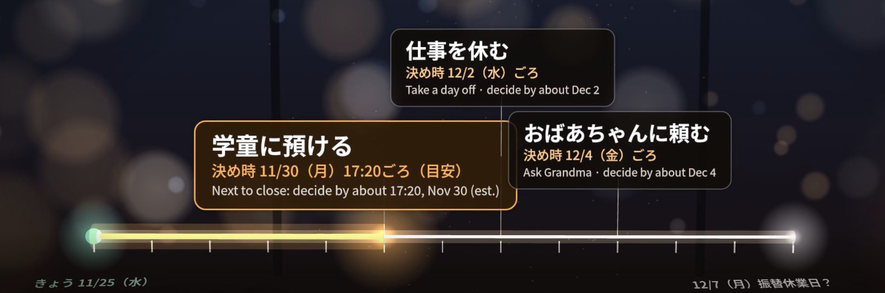
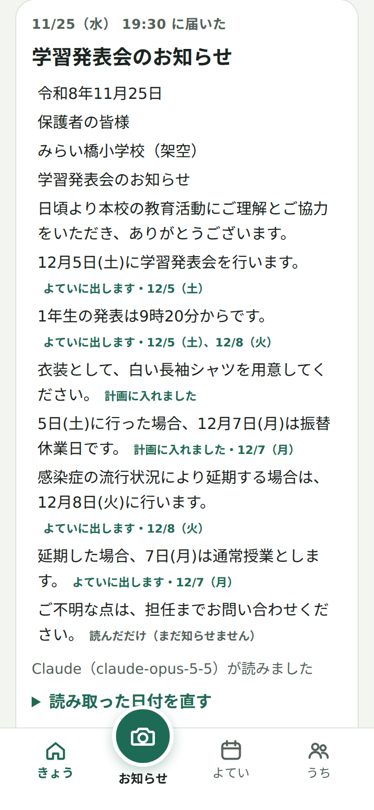
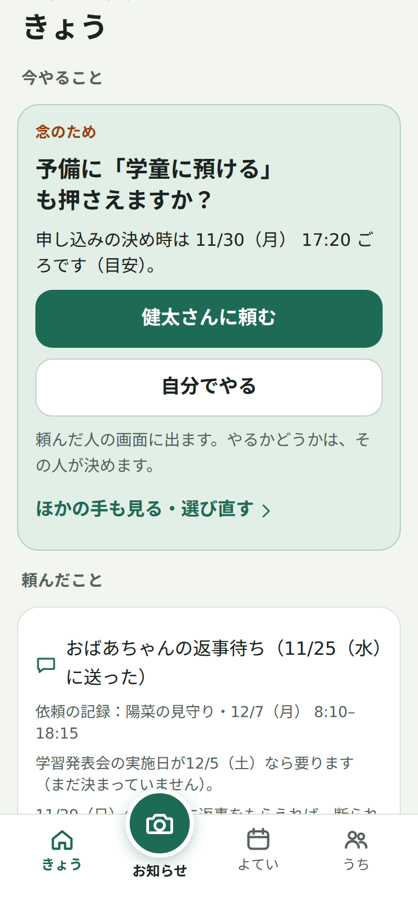
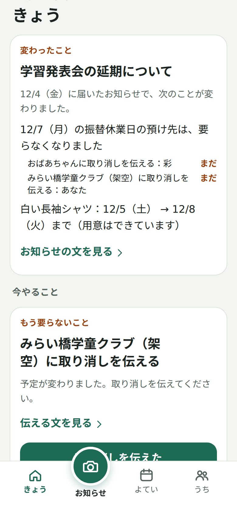
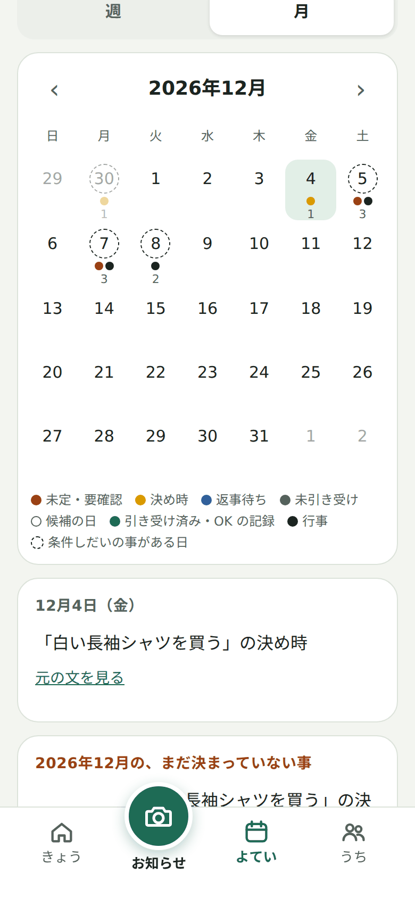
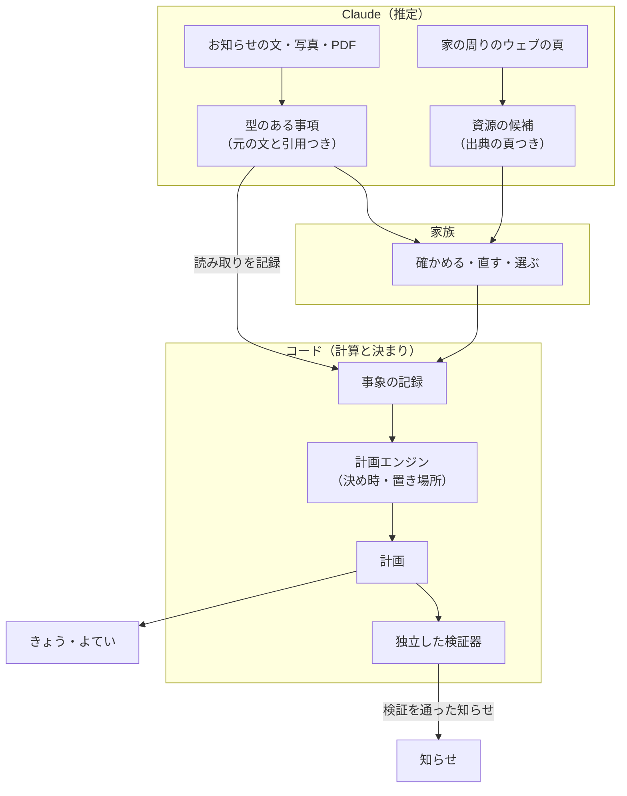

<p align="center">
  
</p>

<p align="center">
  <a href="https://maniauserver-production.up.railway.app"><b>公開デモを開く</b></a>
  &nbsp;&nbsp;·&nbsp;&nbsp;
  <a href="#3-分で見る">3 分で見る</a>
  &nbsp;&nbsp;·&nbsp;&nbsp;
  <a href="README.en.md">English</a>
</p>

<p align="center"><sub>Built with Claude: Japan 2026 応募作品 ・ 登録なし、架空の家族で試せます ・ MIT</sub></p>

<br>

## 予定を入れても、段取りは残る

園や学校からお知らせが届くと、カレンダーに予定を入れて終わり、とはなりません。いつまでに決めれば間に合うか。だれに頼むか。返事はまだか。予定が変わったら、頼んだことをどう片付けるか。共働きの家庭では、こうした段取りを、家族の一人が頭の中に抱えることがあります。

**まにあう**は、この段取りを家族で分け持つための AI です。まだ選べるうちに、間に合わなくなる所と次の一手を示し、家族のだれかが引き受けるまで追いかけます。見守り方を選ぶのも、連絡を送るのも家族です。

| | 日本の学校と、働く親 |
|:--|:--|
| **7.4%** | 平日に開く学童 25,928 か所のうち、19:01 以降まで開くのは 1,912 か所（[こども家庭庁の調査](https://www.cfa.go.jp/assets/contents/node/basic_page/field_ref_resources/69799c33-85cb-44f6-8c70-08ed3a292ab5/c253a682/20251222_policies_kosodateshien_houkago-jidou_80.pdf#page=11)、2025-05-01 時点） |
| **事由の外** | 法の定める子の看護等休暇は、授業参観や運動会への参加を事由に含みません（勤務先が独自に含めることはあります。[厚生労働省の Q&A](https://jsite.mhlw.go.jp/shiga-roudoukyoku/content/contents/002519187.pdf#page=5)） |
| **振替休業日** | 土曜の行事の後に平日が休みになると、その日の預け先や仕事の調整が要ることがあります |

作り手も、日本で子どもを育てている親です。

<br>

## まにあうがすること

<p align="center"></p>

家の情報から計算できる手には、選べる最後の時（決め時）の目安があります。まにあうは、次に消える手と、その時までに決めることを示し、だれかが引き受けるまで追いかけます。

| ① 読む | ② 決め時を比べる | ③ 返事を追う | ④ 変われば、片付ける |
|:-:|:-:|:-:|:-:|
|  |  |  |  |
| Claude がお知らせを読み、文ごとに、どう扱ったかを残します | 計算できる手は、選べる最後の時（決め時）の目安と、選んだら始まる作業を、コードが出します。確かめられない時はそう示します | 返事の記録がないまま、ほかの手の決め時が迫れば、予備にするかを聞きます | 延期で要らなくなった手配と、取り消しを伝える相手を出します |

<br>

## たとえば：一つのお知らせから、二週間

健太と彩は共働きで、小学 1 年の陽菜がいます（架空の家族です。お知らせの読み取りは前に録った物で、デモを開く時に Claude へは送りません）。

| 日 | 起きること | まにあう |
|:--|:--|:--|
| **11/25（水）** | 学習発表会のお知らせ。「5日(土)に行った場合、12月7日(月)は振替休業日です」「白い長袖シャツを用意してください」 | 12/7 に陽菜を見てもらうこと（発表会が 5 日にあれば）と、シャツの用意を出します。どの文から読んだかも残します |
| | 預け先を比べる | 手ごとに、選べる最後の時（決め時）を出します。学童なら 11/30（月）の夕方まで、健太か彩が休むなら 12/2（水）の夕方まで、おばあちゃんに頼むなら 12/4（金）の夜まで（どれも目安）。選んだら何が始まるかも見せます。シャツが家に無いと答えると、健太の帰り道に、家族が「いつも使う」とした店で買う作業を提案します |
| | 彩がおばあちゃんに頼む | 頼む文を下書きします。送るのは彩で、「送った」と記録して返事を待ちます |
| **11/29（日）** | 返事の記録がまだない | 学童の決め時が次の日に迫るので、彩に「予備に学童も押さえますか」と聞きます |
| **11/30（月）** | 予備に学童も申し込む | この例では、すでに引き受けた健太が申し込み、その記録が残ります |
| **12/4（金）** | 延期のお知らせ | 12/7 の預け先は要らなくなり、おばあちゃんと学童に取り消しを伝える作業が、頼んだ人と申し込んだ人に出ます（伝える文の下書きつき） |

同じ仕組みで、クラブの練習日のように、候補の日と答える人の答えから日を決めることもできます（架空の例）。

<br>

## ここが違う

**1. 決め時は、コードが計算する。**
Claude は読むことと調べることを受け持ち、日付・決め時・作業の置き場所はコードが計算します。「なぜこの日までか」を、元の文と家のふだんの一週間までたどれます。

**2. 引き受けるまで、変わった後まで追う。**
だれが引き受けたか、返事が記録されたか、予定が変わったらだれに何を伝えるかを、計画として持ち続けます。

**3. 家の周りを、家族と Claude で保つ。**
Claude が家の地域の病児保育・一時保育・ファミリー・サポートをウェブで調べ、読んだ頁を出典に候補を出します。入れるか、事前の登録が要るか、いつもの店はどこかは家族が決め、まにあうはそれを覚えて計算に使います。勝手に替えません。

**4. 知らせる前に、別に書いた検証器が確かめる。**
計画エンジンと別に書いた検証器が、計画と知らせを確かめ、違反があれば、その知らせ（絞れなければ全部）を止めます。確かめられない所は「未判定」と言い、「問題なし」とは言いません。

**5. 選ぶのも、送るのも家族。**
見守り方や日を決めるのも、頼む連絡や取り消しの連絡を送るのも家族です。お知らせから推定した事は推定と示し、家族が確かめるまで、確かな事として作業にしません。

| 周りの資源 | 保存の前に、変わることを見る | 月の暦 |
|:-:|:-:|:-:|
|  |  |  |
| 事前の登録が済んだかは家族が入れ、調べた事からは「済んだ」にしません | 家の情報を直す時は、保存の前に「この変更で変わること」を見せます | まだ決まっていない事・決め時・返事待ちを印で出し、条件しだいの日を点線で囲みます |

<sub>画面はすべて架空のデモの家族です。</sub>

<br>

## しくみ



- 家族が記録した変更と、お知らせの読み取りを事象に残し、計画はいつも事象から計算し直します。予定は、元のお知らせの文や家族の言ったことに結び付いています。
- 検証器は計画エンジンを読み込まずに書き（書式の規則で止めています）、家の情報と事象から独立に照らします。
- 試験は API なしで走ります（架空の材料で録った Claude の応答を使います）。

<details>
<summary><b>Claude とコードの受け持ち</b>（表）</summary>

<br>

モデルは、読むこと・調べること・書かれていない準備の推定・説明を受け持ちます。日付と時刻の計算、決め時、置き場所、知らせるかの判断は、コードで行います。

| | Claude が受け持つ（推定） | コードが受け持つ（計算と決まり） |
|---|---|---|
| お知らせ | 文・写真・PDF を、行事・持ち物・締切・条件・変更の事項に読む | 引用が元の文にあるか、書かれた月日と食い違わないかを照らす。家族が確かめるまで、推定を確かな事として作業にしない |
| 周りの資源 | ウェブで探し、頁を読み、候補と事前の登録の読みを出す | Claude が根拠に挙げた文が読んだ頁の本文にあるかを照らす（引用は出さず、残さない）。家族が入れるまで家の情報に入れない。家族の扱いを替えない |
| 家族の一言 | 記録の案・仮の話・その日だけの一日に直す | 日付は、言い方からコードが求めた日と同じ時だけ入れる。記録は家族が押した時だけ |
| 決め時と置き場所 | ── | 逆算、ふだんの週への差し込み、店・営業時間・歩く時間、重なり、いつもの店 |
| 知らせ | ── | 知らせるかの決まり（決め時が近い・作業を頼まれた等）と、独立した検証器の門 |
| 案 | 店を探す言葉、やり方の案 | 家族が確かめて直すまで、何も変えない |

</details>

<br>

## 目指すところ

- **今の版**：架空の試用で、子ども一人の家族の決め時・頼み事・返事・変更の後始末を、二人の大人の画面で見比べられます。
- **次に**：子どもが二人以上の家族（お知らせがどの子の物かを家族が確かめて結び、見守り・送り迎え・持ち物を子ごとに出す）。家族が自分で家庭を作り、二人の大人がそれぞれの携帯から加わること。まず作り手の家で家庭モードを使い、その結果を見てからほかの家族に試してもらいます。
- **その先**：事象の記録・決め時・引き受け・検証という核は、領域によらない形で書いています。架空の子どものクラブの練習日を、答える人たちの答えで決める例でも試しました。育児の外で使えるかは、その領域の人・資源・期限・例外を調べ、試してから決めます。決めるのは人です。

<br>

## 今の版でできること

- お知らせ（貼った文・写真・PDF）と家族の一言の読み取り。予定から元の文へ戻れ、読み取った日付と、行事の時刻・名前を、元の文の画面で直せます。
- 手ごとの決め時の比べ。「選んだら」「断られたら？」「もし……なら」を、何も書き込まずに同じ計算で見られます。
- 二人の大人への作業の提案と引き受け、頼む文の下書き、返事の記録、返事の記録がない時の確かめ。
- 予定が変わった時の、要らなくなった準備の片付けと、取り消しを伝える文の下書き。
- 周りの資源：Claude による周りの調べ、家族が決める扱いと事前の登録、いつもの店での買い物、家族の地図（地図の鍵があり照会できる試用で使えます。家庭モードではまだ使えません）。
- 「すること」とやり方、候補の日と答えで日を決める「いつにするか」、「よてい」の週と月の暦、確かな事だけをスマホの暦に書き出す .ics（その時点の一度きりの写しで、自動では同期しません）。
- 日本語と英語の画面。

**まだできないこと**：子どもが二人以上の家族。連続する複数日の休みは、間の日が計画に入らないことがあります。周りの調べで入れた所は、子の見守り方の手（頼む・学童に預ける・休む）にはまだなりません。家庭モードの知らせが iPhone の実機に届くかは、まだ確かめていません。詳しくは下の「今の版の範囲」と、[詳しい動きと制限](docs/scope.md#現在の対応範囲と制限)にあります。

<br>

## 3 分で見る

1. [公開デモ](https://maniauserver-production.up.railway.app)を開き、最初の画面で「用意した場面で見る（審査の方へ）」を押します（登録なし）。
2. 画面上部の「場面」を **11/25 → 11/29 → 12/4** と切り替えます。「使う人」で、二人の大人（健太・彩）の画面を見比べられます。
3. 11/25 は「子どもの見守り方を選ぶ」で手ごとの決め時を、11/29 は彩の画面の予備の問いを、12/4 は「もう要らないこと」を見ます。

ほかの試し方（自分で家族を作る、見本の家族、日を決める場面）は、下の「デモの見方」にあります。

<br>

## Claude と Claude Code

**製品の中**：お知らせの読み取り・写真と PDF の書き起こし・家族の一言・やり方の案・店を探す言葉・周りの調べの六つの呼び出しの既定のモデルは、Claude Opus 5.5 です。五つは型（Zod）を決めた構造化出力で返させ、周りの調べはサーバー側の web_search と web_fetch で探して読ませます。根拠に挙げた文が読んだ頁の本文にあるかは、コードが照らします。

**作る時**：開発は Claude Code を中心に進めました。

- **サブエージェント**で、始める前の調査を 6 分野に分けて並行に調べ、検証器の見直しを書いた本人の判断を渡さずに任せて、見逃し 7 件と誤報 3 件を再現の試験つきで見つけました。
- **フック**で、ホーム以下などの対象外のパスへの道具の使用を、検出できる範囲で止め（見抜けない書き方があるので、これだけに頼りません）、コミットの前に鍵の形や材料の写しを検査します。
- **claude-api の Skill** の資料で、Opus 5.5 の思考・effort・構造化出力の制限を確かめ、比べる相手（強い Claude 単体）の出力の上限を不当に低くしていたのを直しました。
- **評価を、プロンプトを直す側から切り離し**、直す側は取っておく場面を見ていません。

選んだ理由と、効いたこと・効かなかったことは [Claude の使い方の記録](docs/dev/claude-usage.md)にあります。

<details>
<summary><b>使っている Claude の機能（製品の中）</b></summary>

<br>

- **モデル**：六つの呼び出し（お知らせの読み取り・写真と PDF の書き起こし・一言・やり方の案・店を探す言葉・周りの調べ）の既定は Claude Opus 5.5（effort medium）。設定は `apps/server/src/reading/model.ts` の一か所で、速いモードは環境変数で入れます。
- **構造化出力**：周りの調べのほかの五つは、型（Zod）を決めた構造化出力で返させます。周りの調べは文で返る JSON を、同じく型で検査します。
- **画像と PDF の入力**：お知らせの写真・PDF をそのまま読ませます。呼ぶ前に同じ要求の形で入力の tokens を数え（count_tokens）、大きすぎる物は断ります。
- **サーバー側のウェブ検索と頁の取得**：周りの調べは、web_search と web_fetch（回数の上限つき）で探して読ませ、止まった応答（pause_turn）は続けさせます。根拠に挙げた文が、取得した頁の本文にあるかはコードが照らします。

</details>

<details>
<summary><b>開発での Claude Code の使い方</b>（表と詳しい説明）</summary>

<br>

| 機能・進め方 | 何のため | 証拠 |
|---|---|---|
| `claude-api` Skill | API の思考・出力の制限を確かめ、比較相手の出力上限を見直す | [使い方の記録](docs/dev/claude-usage.md)・[比較の実行器](eval/run-baseline.mjs) |
| PreToolUse フック | ホーム以下などの対象外パスを、検出できる範囲で止める | [設定](.claude/settings.json)・[フック](.claude/hooks/guard-paths.py)・[試験](tests/hooks/test_hooks.py) |
| Git の pre-commit フック | 公開前に、鍵の形や手元だけの材料の写しを検査する | [フック](scripts/git-hooks/pre-commit)・[試験](tests/hooks/test_hooks.py) |
| サブエージェントの独立した見直し | 検証器の見逃しと誤報を、実装した担当と別の目で探す | [使い方の記録](docs/dev/claude-usage.md)・[検証器の試験](packages/verify/test/plan.test.ts) |
| サブエージェントの隔離した作業 | 「あした」の基準日を、ほかの画面作りとぶつからずに直し、差分を見直して取り込む | [使い方の記録](docs/dev/claude-usage.md)・[日付の扱い](packages/core/src/reading/output.ts) |
| 評価の担当を分ける | 場面と採点を先に固め、調整する側に取っておく場面を見せずに比べる | [評価の方法と結果](eval/results/g2-summary-20261104.md) |

- **サブエージェントで、並行に調べ、独立に見直す**：始める前の調査を 6 分野に分けて並行に調べました（[docs/research](docs/research)）。公開の前の見直しと検証器の見直しは、書いた本人の判断を渡さないサブエージェントに任せ、検証器の見逃し 7 件と誤報 3 件を、再現の試験つきで見つけました。
- **フックで、決まりを機械で守る**：Claude Code の PreToolUse フックで、リポジトリの外を指すパスへの道具の使用を、見つけられる物は止めます（決めた置き場は許し、変数で組み立てたパスなどは見抜けないので、これだけに頼りません）。Git のフックで、コミットの前に作者のメール・鍵の形・置き場所・材料の写しを検査します（試験は [tests/hooks](tests/hooks)）。
- **後で替えにくい選択は、互いの結論を見ずに考えてから突き合わせる**：二つのエージェントが同じ問いに別々に答えてから比べ、保存を SQLite から Postgres に、ログインを Cloudflare Access に改めました。作業を 15 分刻みで置くと、実際にある 10 分の窓（17:20〜17:30）を落とすことも、ここで見つけて分の精度に直しました。
- **評価を、プロンプトを直す側から切り離す**：場面・正解・採点を作る担当と、製品のプロンプトを直す担当を分け、直す側は取っておく場面を見ていません。開発と評価での Claude API の呼び出しは、記録できた回数と分かった費用を記し、分からない物はそう書いています。
- **API は記憶でなく資料で確かめる**：claude-api の Skill の資料で、Opus 5.5 の思考・effort・構造化出力の制限を確かめ、比べる相手（強い Claude）の出力の上限を不当に低くしていたのを直しました。Managed Agents は、サブエージェントに資料を読ませて製品の必要と照らした上で、今週は使わないと決めました。
- **画面は、Artifact の画布で作り手と見ながら決める**：携帯の幅の画面を並べ、作り手の指摘（専門の道具に見える、使える助言には場所が要る）で作り直してから、コードを書きました。

</details>

<br>

## 確かめた事

少ない架空の場面での確認で、一般の正答率や、まにあうとモデルの優劣は言いません。回数・費用・条件は [Claude の使い方の記録](docs/dev/claude-usage.md)に、比べの集計は [eval/results](eval/results) にあります。

- **強い Claude との比べ**：強い Claude は多くの場面を解きました。満たさなかった確認点は「判断できない時にそう示す」と「未確定を確定と扱わない」に集まりました。差は「モデルには解けない」ではなく、確かめられる状態と、後の変化の扱いに置いています。
- **試験**：API なしで走ります。2026-11-08 に `1fc525c` で、`pnpm check` の計 2,650 件と、ブラウザの通し試験 `pnpm e2e` の 39 件が通りました。
- **画面**：携帯の幅（390px）で、日本語と英語の主な流れを通しています。iPhone の実機と、知らせが本当に届くかは、まだ確かめていません。

<details>
<summary><b>確かめた事の詳しい中身</b></summary>

<br>

- **強い Claude との比べ**（評価の担当が場面・正解・採点を先に固め、プロンプトを直す側は取っておく場面を見ていません）：強い Claude は多くの場面を解きました。満たさなかった確認点は「判断できない時にそう示す」と「未確定を確定と扱わない」に集まり、別の一場面では、6 回の答えのすべてに、確かめていない事を確かな否定として書いた所がありました（確認点の外の観察）。まにあうは、家族が確かめた事実を記録から再生し、比べられる取っておく 3 場面で確認点 12 のうち 11 を満たし（1 は画面で確かめていないので未判定）、検証器の違反はありませんでした（入力が違うので、同じ条件の比べではありません）。差は「モデルには解けない」ではなく、確かめられる状態と、後の変化の扱いに置いています。
- **周りを調べる**：記録の調べでは、7 頁を読み、候補 6 件を出し、外した物は 0 件でした（約 0.54 ドル）。取っておく場面での評価は、数が少なく、一般のモデルより優れるとは言えないと記録しています。
- **家の場所から周りを調べる**：公共の施設の住所（区役所）で一度、本物の地図と Claude で通しました。地図は住所の候補を返し、調べは候補 7 件（区と社会福祉協議会の頁）を出しました（約 0.51 ドル。市区町村の目安を外す前の版）。候補を名前で地図に探すと、別の施設が出ることがあったので（ある病児保育室の名前で、近くの別の 3 所が出た）、家族が同じ所を選んでから徒歩を見せる作りにしました。
- **試験**：2026-11-08 に `1fc525c` で `pnpm check` を実行し、core 495・検証器 747・画面 681・サーバー 727 の計 2,650 件が通りました。ブラウザの通し試験（`pnpm e2e`）も、同じ版で 39 件が通りました。
- **画面**：携帯の幅（390px）の画面で、日本語と英語の主な流れを通しています。iPhone の実機と、知らせが本当に届くかは、まだ確かめていません。

</details>

<br>

## もっと詳しく

<details>
<summary><b>三つの核の詳しい動き</b>（周りの資源・決め時と次の一手・引き受けと片付け）</summary>

### 1. 周りの資源 ── 家族と Claude が一緒に保つ

- **Claude が調べる**：「周りを調べる」で、Claude がウェブ検索で家の地域（見本の家族は区と駅、名前だけの試用は家族が入れた町名まで）の病児保育・一時保育・ファミリー・サポートを探し、頁を読んで候補を出します。候補にするのは、Claude がその場で本文を読んだ頁に、全角・半角と空白をそろえた上で、Claude が根拠に挙げた文（引用）がある物だけです（コードが照らします。文字が合うことは、その文がまとめを支えることも、読みが正しいことも示しません）。引用として抜き出した文は照らすためにだけ使い、画面には出さず、残しません。まとめは Claude が書いた一文で、頁の言葉や文を含むことがあります（まとめが頁の文そのものか、根拠に挙げた文を含む時は、その文がそろえて 8 字以上なら出しません）。家族は出典の頁を開いて確かめます。
- **家の場所から、家からの道のりまで**：名前だけの試用では、家の場所を二つの欄で入れます。地域の欄（都道府県・市区町村・町名）は家の情報に残し、周りを調べる時に Claude に送ります。丁目・番地の欄は、地域の欄と合わせて地図（Google）で場所を探すのにだけ使い、残しません。地図で見つけた場所は、家族が「合っている」と確かめた時だけ、その場所を指す place ID を試用に残します。調べた候補ごとに、候補の名前を手がかりに家の近くを地図で探し、家族が出典の頁の所在地と比べて同じ所を選ぶと、家からの徒歩を見せます（別の施設も出るので、家族が選びます。地図の名前・住所・徒歩は取っておきません）。
- **家族の地図**：試用では家や学校、店などの場所を探し、住所を見て家族が選んだ場所を地図に結べます。結んでいない場所は一覧に残し、位置を勝手に決めません。周りの調べの候補も、同じ所と確かめてから地図に結べます。場所を足しただけでは、ふだんの予定や見守り方には入りません。
- **家族が決める**：入れるか、扱い（いつも使う・候補・使わない）、事前の登録が要るか、だれの分かは、候補ごとに家族が選びます。Claude の読みは読みとして見せ（出典の頁へのリンクつき）、「登録が済んだ」「使える」「空いている」とは言いません。
- **覚えて、勝手に替えない**：その品物のために家族が店を選んでいればその店に、そうでなければ家族が「いつも使う」とした店に、ほかの店が先に寄れても買い物を置きます。その店に寄れる時が無ければ、黙ってほかの店に移さず、訳を出して家族に選んでもらいます。調べ直しても、家族の扱いは替わりません。
- **計算に効く**：済んだと確かめていない事前の登録がある手と、「使わない」とした所を使う手は、お勧めしません。新しく入れた所は、今のやり方を写して使えます（前の所の時間・費用・期限は写しません）。

### 2. 決め時と次の一手 ── コードが計算する

- お知らせ（貼った文・写真・PDF）を Claude が型のある事項に読み、どの文から読んだかを残します。
- 事項と家の情報（人・ふだんの一週間・取れる手とその締切・周りの資源）から、手ごとに「いつまでに決めれば間に合うか」を計算します。帰り道の買い物は、デモで地図の鍵があり調べられた時は、Google マップの駅から店までの歩く時間と営業時間で置き、調べられなければ家の目安で置くか、まだ判断できないと示します（家族の家庭では、まだ地図の値を使いません）。
- 「選んだら」「断られたら？」「もし……なら」（休めたら・会議が延びたら）を、何も書き込まずに同じ計算で見せます。家の情報を直す時も、保存の前に「この変更で変わること」を見せます。

### 3. 引き受けて、片付けるまで ── 検証器が見張る

- 作業は大人の一人に提案し、本人が引き受けるまで「引き受け待ち」と見せます。頼み事は、返事待ちと確定を分けます。子の見守りの頼み事と、時間の決まった「すること」の頼み事は、返事の記録が無ければ、頼んだ時間の 26 時間前から、頼んだ本人の「今やること」に上げて確かめを促します（子の見守りで予備を確保している時などは上げません。締切だけの「すること」は、返事の期限を決めていないので上げません）。
- 延期や取り消しで要らなくなった準備は外し、頼んだ相手への取り消しの連絡を下書きします（送るのは家族です）。
- 知らせは、決め時が近い時、ほかの大人から作業を頼まれた時、お知らせから読んだ「すること」が、読み取りから 1 時間たっても確かめられていない時（知らせる相手は、お知らせを入れた人）など、決まりに合う時に出します。夜は、朝まで待てる物を送りません。送る前に、計画エンジンと別に書いた検証器が計画と知らせを確かめ、違反があれば知らせを止めます。

### 領域によらない核と、最初の領域の部品

- **領域によらない核**：事象の記録と出典、締切か時間の窓を持つ「すること」、やり方とその手順・前提、決め時の逆算、提案・引き受け・頼み事・返事を分けて持つ状態、変更の差分と取り消しの下書き、仮の計算（「選んだら」「断られたら？」）、日の候補と答え（答える人・答えの出所・数え・決めた時の控え）、周りの資源と家族の扱い、知らせの判断、独立した検証器。
- **最初の領域の部品**（今は共働きの子育て家庭に合わせた所）：事項とやり方の種類の一部（子の居場所・持ち物・送り迎え・学童）、お知らせの読み取りと周りの調べのプロンプト、調べる資源の種類（病児保育・一時保育・ファミリー・サポート）、家族の役割（大人・子・頼める人）と、日本の祝日・時区、デモの家族。
- 画面から足せる周りの資源は、店と、周りの調べで見つけた所だけです（任意の種類の所は作れません）。ほかの領域で使えるかは、その領域の人・資源・期限・例外を調べ、試してから決めます。

</details>

<details>
<summary><b>デモの見方</b>（初めから試す・見本の家族・用意した場面・周りの資源）</summary>

### 初めから試す

1. 「はじめる」を押し、架空の大人と子どもの呼び名を入れます。今は子ども一人の試用です。
2. 「例で試す」のお知らせを入れます。例は前に用意した読み取りを使い、今 Claude には送りません。
3. 見守りについて聞かれたら、分かる範囲を入れ、変わることを見てから記録します。分からない時間はそのまま残せます。この後の 4〜6 を試すには、架空の例として、大人ごとに「ふだんの平日（月〜金）」を「出社する」、その日を「ふだんどおり」にして記録してください（見られると答えた時間には、手配は出ません）。
4. 決める画面の「取れる手を足す」で、頼める人と期限を足します（学童に一日預ける手、大人が一日休む手も、締切を選んで足せます。足した手ごとに、決め時を比べられます）。手を選んで、頼む文を見ます。連絡を送るのは家族です。送った後に「送ったことを記録」を押すと、きょうの「頼んだこと」で返事を待ちます。返事も家族が「OK だった」などで記録します。
5. 返事を記録しないまま「操作」を開き、「+1日」「+1時間」で、頼んだ時間の 26 時間前から始まりの前までに進めます。頼んだ本人の「今やること」に相手の返事を確かめる札が出て、この試用の知らせの候補にも出ます。「OK だった」を押せば消えます。
6. 試用の時計が 12/4 17:52 以降なら（5 まで進めていれば過ぎています）、「操作」の「例の続きを足す：学習発表会の延期について（架空）」を押せます（前に用意した読み取りで、Claude には送りません）。この例の 12/7 の見守りが要らなくなり、それを頼んだと記録した本人の「今やること」に「もう要らないこと」が出ます。「伝える文を見る」で取り消しを伝える文を見て、伝えた後に「取り消しを伝えた」を押すと消えます。
7. 下の「うち」を開き、「周りの資源」で家の場所を入れます。住所のほかの家族の情報は架空のままにし、住所は実在の物を入れられます（自分の家の住所を使いたくなければ、近くの駅や公共の施設の住所でも試せます）。地図で見つけた場所が合っていれば「この場所で合っている」を押し、「周りを調べる」で Claude にいま調べてもらいます（1 分ほど。一つの試用で 3 回、サーバーのプロセスごとに一日〔UTC〕30 回まで。読み取りの鍵を設定したサーバー）。候補の「家からの道のりを地図で調べる」で同じ所を選ぶと、家からの徒歩が出ます（地図の鍵を設定したサーバー）。

名前だけの試用の家の設定では、大人と子の呼び名、ふだんの週、頼める人、家の場所などを入れられます（お知らせや「すること」も足せます）。子の見守り方の手は、頼める人に頼む・学童に一日預ける・大人が一日休むの三つを足せます（締切と、学童の一日の費用・見てもらえる時間は家族が入れます。時間単位の休みは、まだ足せません）。要る時間の一部しか見てもらえない手（学童の時間が短い、休む人にその日の手が離せない時間がある）は、見てもらえない時間を書き、選べないようにしています。使えなくなった手は「使えない」にできます（また使う時は、新しく足します）。子の習い事の送り迎えの決まり（行き・帰り）も選べます。「すること」は、何を・いつまでに・だれがするかだけでも足せます。「きょう」の「みんなの都合を聞いて日を決める」では、候補の日を出し、答えを記録して日を決められます（頼む・引き受ける前なら、候補の日を直せます）。買い物に使う駅・帰り道は足せないので、帰り道の店で買う時の計算は、見本の家族で見られます（見本の家族は別の試用として始まり、今の記録は移りません）。

試用の時計は現実の日時とは別です。試用はサーバーのメモリに保存し、一定時間使わないと消えます。自分で書いた架空のお知らせを読み取る時は、文を Claude に送ります（読み取りを使えるサーバーの場合）。

### 見本の家族で試す

最初の画面で「見本の家族で試す」を押すと、ふだんの週・学童・頼める人（おばあちゃん）・二人の休みが入った家族で始まります。「例で試す」のお知らせを入れ、「子どもの見守り方を選ぶ」で、四つの手の決め時と、次に消える手を比べます。

### 用意した場面を見る

最初の画面で「用意した場面で見る（審査の方へ）」を押します。画面上部の「場面」で時点を、「使う人」で二人の大人（健太・彩）を切り替えます。各場面の見どころは、画面の上にも一行で出ます。

1. **11/25 お知らせが届いた**：学習発表会のお知らせから、12/7 の陽菜の預け先と、シャツの用意が出ます。「子どもの見守り方を選ぶ」で、手ごとの決め時と「選んだら」を比べます。
2. **11/26 帰りの買い物**：彩がおばあちゃんに頼み、返事を待っています。健太には、帰り道の店でシャツを買う作業が出ます。家族が「いつも使う」とした店です。地図の鍵があるサーバーで調べられた時は、歩く時間と営業時間は Google マップの物です（調べられなければ、家の目安と書きます）。
3. **11/29 返事がまだ**：学童の決め時が近づき、彩の画面で、予備を押さえるかを聞きます。同じ画面の「断られたら？」で、断られた時の計算を見られます。
4. **11/30 学童にも申し込んだ**：予備に学童を押さえ、おばあちゃんの返事を待っています。
5. **12/4 延期のお知らせ**：要らなくなった預け先と、取り消しを伝える相手（二人で分担）が出ます。
6. **12/5 見てもらう日を決める**：
   1. 「きょう」の「陽菜を見てもらう」を開き、おばあちゃんと近所のサトウさんの答えを見ます。
   2. サトウさんのリンクを「出し直す」で出し、別のタブかブラウザで開きます。
   3. 相手の頁で 12/13 に「はい」と答え、家族の画面に戻って「最新の答えを読む（ほかの画面やリンクから届いた答え）」を押します。
   4. 12/13 の「この日に決めたら変わることを見る」を開いて「この日に決める」を押し、「この日の手配を見る」に進みます。
7. **12/6 練習日を決める**：
   1. 「きょう」の「クラブの練習」を開き、6 人以上の「はい」とコーチの「はい」が要ることを見ます。
   2. コーチのリンクを「出し直す」で出し、別のタブかブラウザで開いて、12/19 に「はい」と答えます。
   3. 家族の画面で「最新の答えを読む（ほかの画面やリンクから届いた答え）」を押し、答えと、答えで変わりうる人を見比べます。
   4. 12/19 の「この日に決めたら変わることを見る」から日を選び、「この日の手配を見る」で体育室の手配を見ます。
8. **12/6 手が離せない時間**：健太が、12/19 の 9:30–10:30 に手が離せない時間（家でのオンライン会議）を記録しました。練習日の候補 12/19 に「重なります」の一行が出ます（答えと数えは変えません）。「うち」の一覧からその日を開いて外すと、一行も消えます。作業の置き場にも効きます：「11/26 帰りの買い物」の場面で、健太の 11/26 に 18:30–19:30 を足して見ると、シャツを買う作業が 11/27 に動きます。

答えるリンクはデモの家庭でだけ使えます。リンクを持つ人が答えられ、本人かは確かめません。人数や答えの条件を満たしても、会場に空きがあることは確かめていません。頼んだり引き受けたりした後に日を替える時は、その「すること」を「要らない」にして作り直します。

デモは知らせを送りません。その時刻の知らせの候補（まだ送っていないとした時）を、「きょう」の画面の上のデモの帯に、閉じたまとめで出します。開くと、今の候補と、夜なので朝まで待つ候補を分けて、ロック画面の文が読めます。候補は、11/29 は彩にだけ、12/4 は二人に一つずつあります。夜（22時から）は、朝まで待てる知らせを朝 7 時まで待たせます（時計を進めて試せます）。

**周りの資源を見る**：下の「うち」から「周りの資源」へ。

- 「周りを調べる」で、デモの家の地域（江東区・豊洲）を 2026-11-05 に Claude が一度だけ本物のウェブで調べて記録した結果が出ます（候補ごとに、読んだ頁へのリンク・Claude のまとめ・事前の登録の読み。頁の全文と、引用として抜き出した文の欄は記録していません。まとめは頁の言葉や文を含むことがあります）。候補の「この家での扱いを決める」を開き、扱いと事前の登録を確かめて「この家の候補にする」を押すと、保存の前に変わることが見え、入れた所に頼むやり方を、今のやり方を写して作れます。「Claude にいま調べ直してもらう」は、一つのデモで 3 回、サーバー全体で一日 30 回までです（読み取りの鍵を設定したサーバー）。
- 「周りの資源を直す」で、店ごとに「いつも使う・候補・使わない」を選べます。場面 2 で、いつもの店（豊洲駅の近くの衣料品店）を「候補」にすると、シャツを買う店がもう一つの店（架空）に替わることが、保存の前に見えます。

お知らせを Claude に読ませるには、下の「お知らせ」から「例文を入れる（架空のお知らせ）」を押してから「読み取る」を押します（読み取りの鍵を設定したサーバー）。

</details>

<details>
<summary><b>今の版の範囲</b></summary>

<br>

- 子ども一人の家族向けです（名前だけの試用で入れられる子は一人で、見本の家族と用意した場面の子も一人です）。
- 連続する複数日の休みは、開始日と終了日だけが読み取られ、間の日が計画に入らないことがあります。各日を確認し、必要な手配を個別に加えてください。
- 公開デモと名前だけの試用は、時計を現実の日時と別に進めて試せます。記録はサーバーのメモリにあり、一定時間使わないと消えます。
- 家族が自分で長く使う家庭を作り、二人の大人がそれぞれの携帯から入る道は、まだありません。家庭モード（本人の確かめ・保存・知らせ）は、設定した人が開く形で作りましたが、実在の家族の暮らしと、iPhone の実機に知らせが届くかは、まだ確かめていません。
- 周りの調べで入れた所は、家の情報と「すること」のやり方には使えますが、子の見守り方の手（頼む・学童に預ける・休む）には、まだなりません。
- 家族の地図で場所を探して結ぶ機能は、地図の鍵があり照会できる公開デモと名前だけの試用で使えます。家庭モードではまだ使えません。

できること・できないことは[詳しい動きと制限](docs/scope.md#現在の対応範囲と制限)にあります。

</details>

<details>
<summary><b>作った物と、これから</b></summary>

<br>

作った物：三つの核、お知らせ・写真・一言の読み取り、「すること」（家族の言ったことやお知らせが求める出席・申し込み）とやり方の表、日の候補と答えで日を決める「いつにするか」（「きょう」から候補を出して始め、頼む・引き受ける前なら候補の日を直せる。答える人ごとのリンクは、デモの家庭だけ）、「よてい」の週と月の暦（月の格子に、まだ決まっていない事・決め時・返事待ち・引き受けの状態などを印で出し、条件しだいの日を点線で囲み、日を押すと持ち物・提出物を含むその日の行を見せる。作業の引き受けの状態、頼み事の返事の記録、時刻を決めていない作業、元の文への道）、確かな事だけをスマホの暦に書き出す .ics（一度きりの写し）、地図の買い物、入れ間違えたお知らせをまとめて外すこと、元の文の画面での読み取った日付・行事の時刻と名前の直しと一件だけ計画から外すこと、「あした」「きょう」をお知らせが書かれた日から数えること（選ばなければ推定として家族に確かめてもらう）、頼んだ後に日や時間が変わった時の頼み直し（同じ日の時間の変更のお願いを含む）、家庭モード（Cloudflare Access での本人の確かめ・Postgres への保存・Web Push の知らせ。実機の iPhone では、まだ確かめていません）。

これから：

- 子どもが二人以上の家族：お知らせがどの子の物かを家族が確かめて結び、見守り・送り迎え・持ち物を子ごとに出すこと。期間の後に、まずこれを作ります。
- 家族が自分で家庭を作り、二人の大人がそれぞれの携帯から加わること（今の家庭モードの家庭は、運営側が用意します）。
- 期間の後は、実在の家族のデータを入れる前の門（[基盤の設計](docs/design/02-foundation.md) §13.1 の 2。実際の環境と iPhone での確かめを含む）を通してから、まず作り手の家で家庭モードを使います。ほかの家族に試してもらうのは、その結果を見てからです。
- 周りの資源の定期の見直し（今は、家族が押した時だけ調べ直します）。
- いつもの所の好みを、やり方のお勧め（いつもの病児保育室など）に使うこと。
- 調べる種類を広げること（今は病児保育・一時保育・ファミリー・サポート）と、家族の家庭での周りの調べ。
- 架空の子どものクラブの練習日を、同じ「すること」の候補と答えの仕組みで試せます。実際の集まりや育児の外で使えるかは、その人・資源・期限・例外を調べてから確かめます。決めるのは人です。
  - 候補ごとに別のやり方を選ぶこと、頼んだり引き受けたりした後に日を替える道、家庭モードの答えるリンクは、まだありません。部活の一季の段取りも、これからです。

</details>

<details>
<summary><b>送る物と、取っておく物</b></summary>

<br>

- デモの初めの家族とお知らせは架空です。入れる文・写真・PDF も、架空の物で試してください。名前だけの試用の家の場所だけは、実在の住所を入れられます。
- Anthropic には、読み取りのために入れた文・写真・PDF、一言、調べる地域（見本の家族は区と駅。名前だけの試用は、家族が地域の欄に入れた文）と種類などを送ります。丁目・番地の欄は送りません（地域の欄は、空白を除いて送ります）。送る物と回数の上限は[詳しい動きと制限](docs/scope.md#自分の文で試す)にあります。
- 名前だけの試用で入れた住所（地域の欄と丁目・番地の欄）は、場所を探すためにだけ Google に送り、丁目・番地の欄は残しません。家族が確かめた家の場所は、その場所を指す place ID を試用に残します（試用が消えると消えます）。調べた候補までの家からの道のりを地図で調べる時は、候補の名前と、確かめた家の場所（place ID と位置）を Google に送ります。
- 家族の地図の場所を探す時は、家族が入力した検索語を Google に送り、確かめて選んだ場所の place ID を家の情報に残します。Google から受け取った名前・住所・営業時間・道は残さず、Claude にも送りません。地図に表示する位置は同じ試用のサーバーのメモリで 15 分を上限に再利用し、期限切れ後に定期的に消します（提供者の表示が必要な位置は控えません）。家族が付けた場所の呼び名と品物は家族の入力として家の情報に入り、調べた時刻も残ることがあります。引き受けた提案の控え〔時刻・歩く分・店の place ID〕は、デモのサーバーのメモリにだけ残ります。[利用規約とプライバシー](https://maniauserver-production.up.railway.app/terms.html)。

</details>

<details>
<summary><b>手元で動かす・開発</b></summary>

### 手元で動かす

Node.js 24 以降と pnpm 11 が必要です。

```sh
pnpm install
pnpm dev
```

[http://localhost:5173](http://localhost:5173) を開きます。サーバーは 8787 番を使います。家庭モードの設定（データベースと Cloudflare Access）が無ければ、デモとして起動します。デモは API キーもデータベースも要りません。用意したお知らせの読み取りと周りの調べには、架空の文と一度の本物の調べから事前に録った Claude の応答を使います。

- `ANTHROPIC_API_KEY` を設定すると（環境変数か、リポジトリ直下の `.env`）、お知らせの文・写真の読み取り、一言、やり方の案、周りの調べ直しを Claude で試せます。架空の文で試してください。
- `GOOGLE_MAPS_API_KEY`（Places API (New) と Routes API だけを許した、サーバーだけに置く鍵）を設定すると、デモの買い物を Google マップの道のりと営業時間で置きます。`GOOGLE_MAPS_BROWSER_KEY`（Maps JavaScript API だけを許し、置き場所の URL に限った鍵）も設定すると、画面で地図を見られます。
- 速いモード：`CLAUDE_FAST_MODE=1` の時だけ、Claude を速いモードで呼びます。

### 開発

```sh
pnpm check
node --test eval/test/*.test.mjs
```

`pnpm check` は書式・型・各パッケージの試験を実行します。変更をコミットする場合は、clone の後に一度だけ `git config core.hooksPath scripts/git-hooks` で検査を有効にします（フックの試験は `python3 -m unittest discover -s tests/hooks`）。

| 場所 | 内容 |
|---|---|
| [apps/web](apps/web) | 携帯向けの画面（日本語・英語） |
| [apps/server](apps/server) | API、保存、知らせ、Claude の読み取りと調べ、地図 |
| [packages/core](packages/core) | 事実の型、時刻、計画エンジン |
| [packages/verify](packages/verify) | 独立した検証器（計画エンジンを読み込まない） |
| [data/demo](data/demo) | 架空の家族とお知らせ、録った応答 |
| [eval](eval) | 境界の場面と比べの仕組み |

設計は [中身の設計](docs/design/01-model.md)と[基盤の設計](docs/design/02-foundation.md)、今週の範囲は[製品の計画](docs/plan/02-product.md)、Claude と Claude Code の使い方（サブエージェントでの並行の調査、守りのフック、評価の独立など）は [Claude の使い方の記録](docs/dev/claude-usage.md)にあります。

</details>

<br>

## ライセンス

[MIT](LICENSE)
