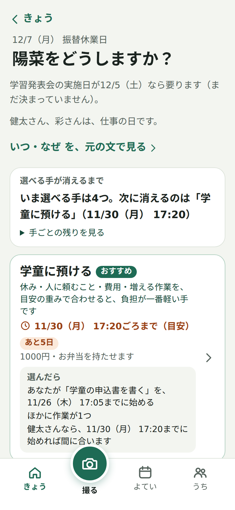
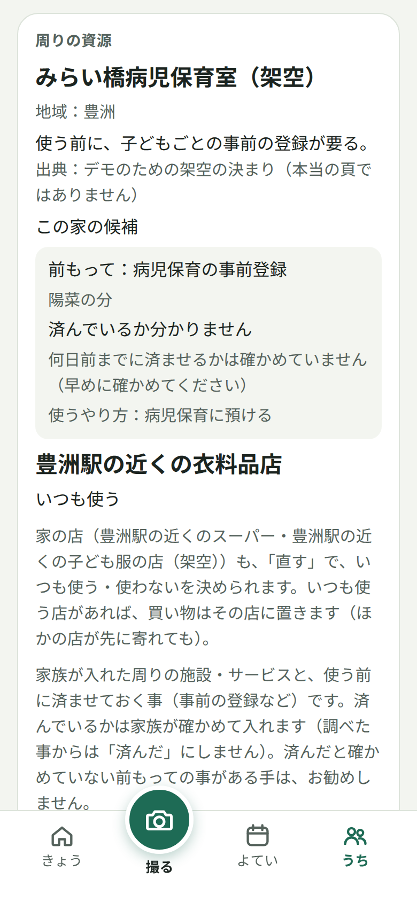
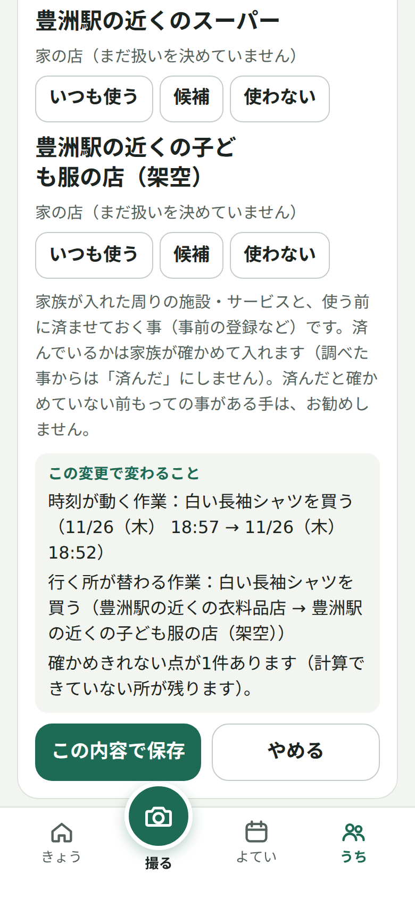
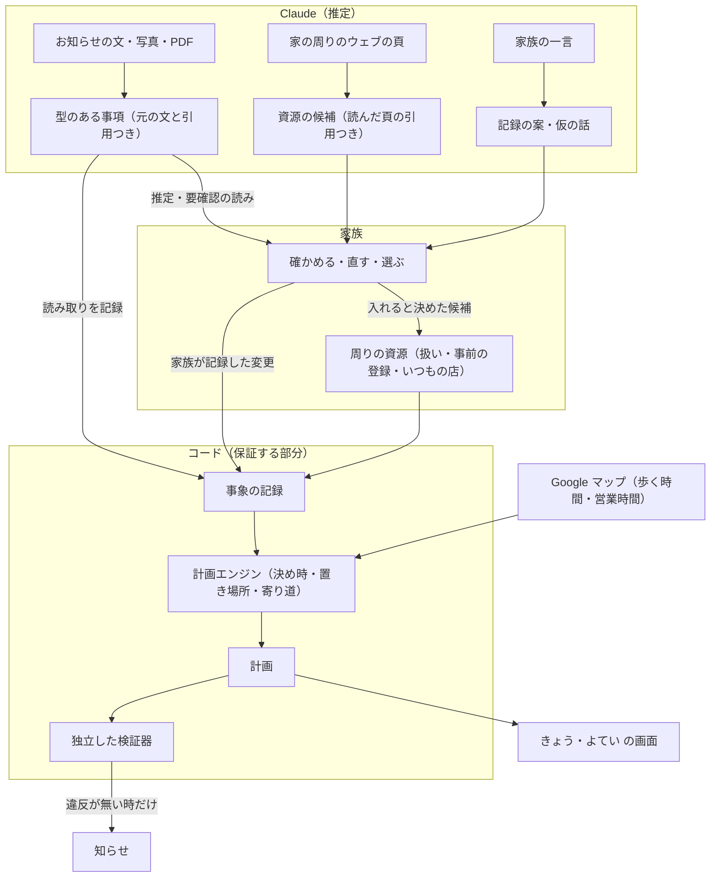

# まにあう

[English](README.en.md)

**共働きの家庭の段取りを、家の周りの資源から計算するアプリ**

家の周りの資源を家族と Claude が一緒に保ち、園と学校のお知らせと家の暮らしから「いつまでに・だれが・何を」をコードで計算して、家族のだれかが引き受けるまでをつなぎます。

**公開デモ：https://maniauserver-production.up.railway.app**（登録なし。架空の家族で試せます。見方は下の[デモの見方](#デモの見方)）

Built with Claude: Japan 2026 応募作品

---

予定をカレンダーに入れても、その日に間に合わせる仕事は残ります。いつまでに決めれば間に合うか、だれに頼むか、返事はまだか、予定が変わったら頼んだことをどう片付けるか。共働きの家庭では、段取りを受け持つ一人が、これを頭の中で抱えています。

しかもこの計算は、家の周りを知っていて初めてできます。病児保育室は使う前に事前の登録が要るか。シャツは帰り道のどの店で、何時までに買えるか。いつもの店はどこか。まにあうは、この「周りの資源」を家族と Claude が一緒に保ち、その上で決め時と次の一手を計算します。選ぶのも、祖父母や学童に連絡するのも家族です。まにあうが代わりに選んだり、連絡を送ったりはしません。

| 決め時を比べる | 周りの資源 | 保存の前に、変わることを見る |
|---|---|---|
|  |  |  |

画面はすべて架空のデモの家族です。

## 三つの核

### 1. 周りの資源 ── 家族と Claude が一緒に保つ

- **Claude が調べる**：「周りを調べる」で、Claude がウェブ検索で家の地域（区と駅の粒度）の病児保育・一時保育・ファミリー・サポートを探し、頁を読んで候補を出します。候補にするのは、Claude がその場で本文を読んだ頁に、全角・半角と空白をそろえた上で引用がある物だけです（コードが確かめます。文字が合うことは、読みが正しいことを示しません）。
- **家族が決める**：入れるか、扱い（いつも使う・候補・使わない）、事前の登録が要るか、だれの分かは、候補ごとに家族が選びます。Claude の読みは原文と並べて読みとして見せ、「登録が済んだ」「使える」「空いている」とは言いません。
- **覚えて、勝手に替えない**：その品物のために家族が店を選んでいればその店に、そうでなければ家族が「いつも使う」とした店に、ほかの店が先に寄れても買い物を置きます。その店に寄れる時が無ければ、黙ってほかの店に移さず、訳を出して家族に選んでもらいます。調べ直しても、家族の扱いは替わりません。
- **計算に効く**：済んだと確かめていない事前の登録がある手と、「使わない」とした所を使う手は、お勧めしません。新しく入れた所は、今のやり方を写して使えます（前の所の時間・費用・期限は写しません）。

### 2. 決め時と次の一手 ── コードが計算する

- お知らせ（貼った文・写真・PDF）を Claude が型のある事項に読み、どの文から読んだかを残します。
- 事項と家の情報（人・ふだんの一週間・取れる手とその締切・周りの資源）から、手ごとに「いつまでに決めれば間に合うか」を計算します。帰り道の買い物は、デモで地図の鍵があり調べられた時は、Google マップの駅から店までの歩く時間と営業時間で置き、調べられなければ家の目安で置くか、まだ判断できないと示します（家族の家庭では、まだ地図の値を使いません）。
- 「選んだら」「断られたら？」「もし……なら」（休めたら・会議が延びたら）を、何も書き込まずに同じ計算で見せます。家の情報を直す時も、保存の前に「この変更で変わること」を見せます。

### 3. 引き受けて、片付けるまで ── 検証器が見張る

- 作業は大人の一人に提案し、本人が引き受けるまで「引き受け待ち」と見せます。頼み事は、返事待ちと確定を分けます。
- 延期や取り消しで要らなくなった準備は外し、頼んだ相手への取り消しの連絡を下書きします（送るのは家族です）。
- 知らせは、もう待てない時だけです。計画エンジンと別に書いた検証器が計画を確かめ、違反があれば知らせを止めます。

## Claude とコードの受け持ち

モデルは、読むこと・調べること・書かれていない準備の推定・説明を受け持ちます。日付と時刻の計算、決め時、置き場所、知らせるかの判断は、コードで行います。

| | Claude が受け持つ（推定） | コードが受け持つ（保証する部分） |
|---|---|---|
| お知らせ | 文・写真・PDF を、行事・持ち物・締切・条件・変更の事項に読む | 引用が元の文にあるか、書かれた月日と食い違わないかを照らす。家族が確かめるまで、推定は計画に入れない |
| 周りの資源 | ウェブで探し、頁を読み、候補と事前の登録の読みを出す | 引用が読んだ頁の本文にあるかを確かめる。家族が入れるまで家の情報に入れない。家族の扱いを替えない |
| 家族の一言 | 記録の案・仮の話・その日だけの一日に直す | 日付は、言い方からコードが求めた日と同じ時だけ入れる。記録は家族が押した時だけ |
| 決め時と置き場所 | ── | 逆算、ふだんの週への差し込み、店・営業時間・歩く時間、重なり、いつもの店 |
| 知らせ | ── | もう待てないかの判断と、独立した検証器の門 |
| 案 | 店を探す言葉、やり方の案 | 家族が確かめて直すまで、何も変えない |

## しくみ



- 家族が記録した変更と、お知らせの読み取りを事象に残し、計画はいつも事象から計算し直します。仮の計算や、まだ確かめていない一言・周りの調べは、事象には記録しません。予定は、元のお知らせの文や家族の言ったことに結び付いています。
- 検証器は計画エンジンを読み込まずに書き（書式の規則で止めています）、家の情報と事象から独立に照らします。確かめられない所は「未判定」とし、「問題なし」とは言いません。
- 試験は API なしで走ります（架空の材料で録った Claude の応答を使います）。core・検証器・画面・サーバーで 1,800 を超える試験があります。

## デモの見方

画面上部の「場面」で時点を、「使う人」で二人の大人（健太・彩）を切り替えます。各場面の見どころは、画面の上にも一行で出ます。

1. **11/25 お知らせが届いた**：学習発表会のお知らせから、12/7 の陽菜の預け先と、シャツの用意が出ます。「決める」で、手ごとの決め時と「選んだら」を比べます。
2. **11/26 帰りの買い物**：彩がおばあちゃんに頼み、返事を待っています。健太には、帰り道の店でシャツを買う作業が出ます。家族が「いつも使う」とした店です。地図の鍵があるサーバーで調べられた時は、歩く時間と営業時間は Google マップの物です（調べられなければ、家の目安と書きます）。
3. **11/29 返事がまだ**：学童の決め時が近づき、彩の画面で、予備を押さえるかを聞きます。同じ画面の「断られたら？」で、断られた時の計算を見られます。
4. **11/30 学童にも申し込んだ**：予備に学童を押さえ、おばあちゃんの返事を待っています。
5. **12/4 延期のお知らせ**：要らなくなった預け先と、取り消しを伝える相手（二人で分担）が出ます。

**周りの資源を見る**：下の「うち」から「周りの資源」へ。

- 「周りを調べる」で、デモの家の地域（江東区・豊洲）を 2026-11-05 に Claude が一度だけ本物のウェブで調べて記録した結果が出ます（候補ごとに、読んだ頁・引用・事前の登録の読み）。候補を「この家の候補にする」で入れると、保存の前に変わることが見え、入れた所に頼むやり方を、今のやり方を写して作れます。「Claude にいま調べ直してもらう」は、一つのデモで 3 回、サーバー全体で一日 30 回までです（読み取りの鍵を設定したサーバー）。
- 「直す」で、店ごとに「いつも使う・候補・使わない」を選べます。場面 2 で、いつもの店（豊洲駅の近くの衣料品店）を「候補」にすると、シャツを買う店がもう一つの店（架空）に替わることが、保存の前に見えます。

お知らせを Claude に読ませるには、下の「撮る」から「例文を入れる（架空のお知らせ）」を押してから「読み取る」を押します（読み取りの鍵を設定したサーバー）。

## 確かめた事

少ない架空の場面での確認で、一般の正答率や、まにあうとモデルの優劣は言いません。回数・費用・条件は[Claude の使い方の記録](docs/dev/claude-usage.md)に、比べの集計は [eval/results](eval/results) にあります。

- **強い Claude との比べ**（評価の担当が場面・正解・採点を先に固め、プロンプトを直す側は取っておく場面を見ていません）：強い Claude は多くの場面を解きました。満たさなかった確認点は「判断できない時にそう示す」と「未確定を確定と扱わない」に集まり、別の一場面では、6 回の答えのすべてに、確かめていない事を確かな否定として書いた所がありました（確認点の外の観察）。まにあうは、家族が確かめた事実を記録から再生し、比べられる取っておく 3 場面で確認点 12 のうち 11 を満たし（1 は画面で確かめていないので未判定）、検証器の違反はありませんでした（入力が違うので、同じ条件の比べではありません）。差は「モデルには解けない」ではなく、確かめられる状態と、後の変化の扱いに置いています。
- **周りを調べる**：記録の調べでは、7 頁を読み、候補 6 件を出し、外した物は 0 件でした（約 0.54 ドル）。取っておく場面での評価は、数が少なく、一般のモデルより優れるとは言えないと記録しています。
- **画面**：携帯の幅（390px）の画面で、日本語と英語の主な流れを通しています。iPhone の実機と、知らせが本当に届くかは、まだ確かめていません。

## 送る物と、取っておく物

- デモの初めの家族とお知らせは架空です。入れる文・写真も、架空の物で試してください。
- Anthropic には、読み取りのために入れた文・写真、一言、調べる地域（区と駅の粒度）と種類などを送ります。送る物と回数の上限は[詳しい動きと制限](docs/scope.md#自分の文で試す)にあります。
- Google から受け取った店の名前・営業時間・道は取っておかず、Claude にも送りません。Google の情報で家の情報に残すのは、地図に結んだ駅と選んだ店の place ID と、調べた時刻だけです（店に付けた家族の呼び名と品物は、家族の入れた物として家の情報に入ります。引き受けた時に見た提案の控え〔時刻・歩く分・店の place ID〕は、デモのサーバーのメモリにだけ残ります。[利用規約とプライバシー](https://maniauserver-production.up.railway.app/terms.html)）。

## 作った物と、これから

作った物：上の三つの核、お知らせ・写真・一言の読み取り、「すること」（家族の言ったことやお知らせが求める出席・申し込み）とやり方の表、地図の買い物、家庭モード（Cloudflare Access での本人の確かめ・Postgres への保存・Web Push の知らせ。実機の iPhone では、まだ確かめていません）。

これから：

- 周りの資源の定期の見直し（今は、家族が押した時だけ調べ直します）。
- いつもの所の好みを、やり方のお勧め（いつもの病児保育室など）に使うこと。
- 調べる種類を広げること（今は病児保育・一時保育・ファミリー・サポート）と、家族の家庭での周りの調べ。

できないこと・確かめていないことは、[詳しい動きと制限](docs/scope.md#現在の対応範囲と制限)にまとめています。

## 手元で動かす

Node.js 24 以降と pnpm 11 が必要です。

```sh
pnpm install
pnpm dev
```

[http://localhost:5173](http://localhost:5173) を開きます。サーバーは 8787 番を使います。家庭モードの設定（データベースと Cloudflare Access）が無ければ、デモとして起動します。デモは API キーもデータベースも要りません。用意したお知らせの読み取りと周りの調べには、架空の文と一度の本物の調べから事前に録った Claude の応答を使います。

- `ANTHROPIC_API_KEY` を設定すると（環境変数か、リポジトリ直下の `.env`）、お知らせの文・写真の読み取り、一言、やり方の案、周りの調べ直しを Claude で試せます。架空の文で試してください。
- `GOOGLE_MAPS_API_KEY`（Places API (New) と Routes API だけを許した、サーバーだけに置く鍵）を設定すると、デモの買い物を Google マップの道のりと営業時間で置きます。`GOOGLE_MAPS_BROWSER_KEY`（Maps JavaScript API だけを許し、置き場所の URL に限った鍵）も設定すると、画面で地図を見られます。
- 速いモード：`CLAUDE_FAST_MODE=1` の時だけ、Claude を速いモードで呼びます。

## 開発

```sh
pnpm check
node --test eval/test/*.test.mjs
```

`pnpm check` は書式・型・各パッケージの試験を実行します。変更をコミットする場合は、clone の後に一度だけ `git config core.hooksPath scripts/git-hooks` で検査を有効にします（フックの試験は `python3 -m unittest discover -s tests/hooks`）。

| 場所 | 内容 |
|---|---|
| [apps/web](apps/web) | 携帯向けの画面（日本語・英語） |
| [apps/server](apps/server) | API、保存、知らせ、Claude の読み取りと調べ、地図 |
| [packages/core](packages/core) | 事実の型、時刻、計画エンジン |
| [packages/verify](packages/verify) | 独立した検証器（計画エンジンを読み込まない） |
| [data/demo](data/demo) | 架空の家族とお知らせ、録った応答 |
| [eval](eval) | 境界の場面と比べの仕組み |

設計は [中身の設計](docs/design/01-model.md)と[地基の設計](docs/design/02-foundation.md)、今週の範囲は[製品の計画](docs/plan/02-product.md)、Claude と Claude Code の使い方（サブエージェントでの並行の調査、守りのフック、評価の独立など）は [Claude の使い方の記録](docs/dev/claude-usage.md)にあります。

## ライセンス

[MIT](LICENSE)
