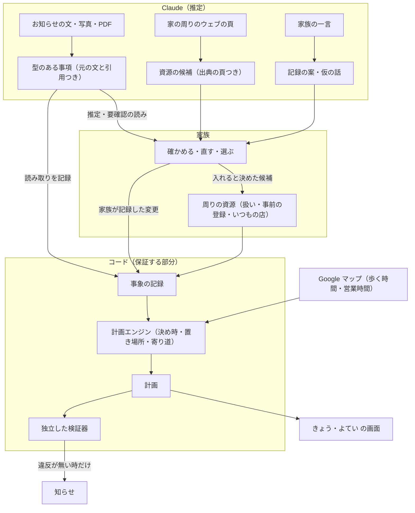

# まにあう

[English](README.en.md)

**選べるうちに人が決め、引き受け、変化にも対応できるよう、周りの資源と段取りをつなぐ AI。まずは共働きの子育て家庭から。**

段取りの中には、予定の日より前に、ある手を選べる最後の時（決め時）があるものがあります。何人かで分け持つと、頼んだことと引き受けたことの違い、返事待ち、予定が変わった後の片付けも加わります。まにあうでは、Claude が散らばった情報を読み、求めに応じて周りを調べ、コードが決め時と「選んだら何が起きるか」を計算し、計画とは別に書いた検証器が確かめます。選ぶのは人です。

この考えは育児に限りません。最初の領域は共働きの子育て家庭の段取りで、架空の家庭の場面で作り、確かめています。家の周りの資源を家族と Claude が一緒に保ち、園と学校のお知らせと家の暮らしから「いつまでに・だれが・何を」をコードで計算して、家族のだれかが引き受けるまでをつなぎます。

**公開デモ：<https://maniauserver-production.up.railway.app>**（登録なし。架空の家族で試せます。見方は下の[デモの見方](#デモの見方)）

Built with Claude: Japan 2026 応募作品

---

予定をカレンダーに入れても、その日に間に合わせる仕事は残ります。いつまでに決めれば間に合うか、だれに頼むか、返事はまだか、予定が変わったら頼んだことをどう片付けるか。共働きの家庭では、段取りを受け持つ一人が、これを頭の中で抱えています。

しかもこの計算は、家の周りを知っていて初めてできます。病児保育室は使う前に事前の登録が要るか。シャツは帰り道のどの店で、何時までに買えるか。いつもの店はどこか。まにあうは、この「周りの資源」を家族と Claude が一緒に保ち、その上で決め時と次の一手を計算します。選ぶのも、祖父母や学童に連絡するのも家族です。まにあうが代わりに選んだり、連絡を送ったりはしません。

| 決め時を比べる | 周りの資源 | 保存の前に、変わることを見る |
|---|---|---|
|  |  |  |

画面はすべて架空のデモの家族です。

## 日本の学校と、働く親

学校の土曜の行事の後に平日が振替休業日になると、その日の預け先や仕事の調整が要ることがあります。[こども家庭庁の調査](https://www.cfa.go.jp/assets/contents/node/basic_page/field_ref_resources/69799c33-85cb-44f6-8c70-08ed3a292ab5/c253a682/20251222_policies_kosodateshien_houkago-jidou_80.pdf#page=11)（2025-05-01 時点）では、平日に開く放課後児童クラブ（学童）25,928 か所のうち、19:01 以降まで開くのは 1,912 か所（7.4%）でした。法の定める子の看護等休暇は、授業参観や運動会への参加を事由に含みません（勤務先が独自に含めることはあります。[厚生労働省の Q&A](https://jsite.mhlw.go.jp/shiga-roudoukyoku/content/contents/002519187.pdf#page=5)）。作り手も、日本で子どもを育てている親です。

## 三つの核

### 1. 周りの資源 ── 家族と Claude が一緒に保つ

- **Claude が調べる**：「周りを調べる」で、Claude がウェブ検索で家の地域（見本の家族は区と駅、名前だけの試用は家族が入れた町名まで）の病児保育・一時保育・ファミリー・サポートを探し、頁を読んで候補を出します。候補にするのは、Claude がその場で本文を読んだ頁に、全角・半角と空白をそろえた上で、Claude が根拠に挙げた文（引用）がある物だけです（コードが照らします。文字が合うことは、その文がまとめを支えることも、読みが正しいことも示しません）。引用として抜き出した文は照らすためにだけ使い、画面には出さず、残しません。まとめは Claude が書いた一文で、頁の言葉や文を含むことがあります（まとめが頁の文そのものか、根拠に挙げた文を含む時は、その文がそろえて 8 字以上なら出しません）。家族は出典の頁を開いて確かめます。
- **家の場所から、家からの道のりまで**：名前だけの試用では、家の場所を二つの欄で入れます。地域の欄（都道府県・市区町村・町名）は家の情報に残し、周りを調べる時に Claude に送ります。丁目・番地の欄は、地域の欄と合わせて地図（Google）で場所を探すのにだけ使い、残しません。地図で見つけた場所は、家族が「合っている」と確かめた時だけ、その場所を指す place ID を試用に残します。調べた候補ごとに、候補の名前を手がかりに家の近くを地図で探し、家族が出典の頁の所在地と比べて同じ所を選ぶと、家からの徒歩を見せます（別の施設も出るので、家族が選びます。地図の名前・住所・徒歩は取っておきません）。
- **家族が決める**：入れるか、扱い（いつも使う・候補・使わない）、事前の登録が要るか、だれの分かは、候補ごとに家族が選びます。Claude の読みは読みとして見せ（出典の頁へのリンクつき）、「登録が済んだ」「使える」「空いている」とは言いません。
- **覚えて、勝手に替えない**：その品物のために家族が店を選んでいればその店に、そうでなければ家族が「いつも使う」とした店に、ほかの店が先に寄れても買い物を置きます。その店に寄れる時が無ければ、黙ってほかの店に移さず、訳を出して家族に選んでもらいます。調べ直しても、家族の扱いは替わりません。
- **計算に効く**：済んだと確かめていない事前の登録がある手と、「使わない」とした所を使う手は、お勧めしません。新しく入れた所は、今のやり方を写して使えます（前の所の時間・費用・期限は写しません）。

### 2. 決め時と次の一手 ── コードが計算する

- お知らせ（貼った文・写真・PDF）を Claude が型のある事項に読み、どの文から読んだかを残します。
- 事項と家の情報（人・ふだんの一週間・取れる手とその締切・周りの資源）から、手ごとに「いつまでに決めれば間に合うか」を計算します。帰り道の買い物は、デモで地図の鍵があり調べられた時は、Google マップの駅から店までの歩く時間と営業時間で置き、調べられなければ家の目安で置くか、まだ判断できないと示します（家族の家庭では、まだ地図の値を使いません）。
- 「選んだら」「断られたら？」「もし……なら」（休めたら・会議が延びたら）を、何も書き込まずに同じ計算で見せます。家の情報を直す時も、保存の前に「この変更で変わること」を見せます。

### 3. 引き受けて、片付けるまで ── 検証器が見張る

- 作業は大人の一人に提案し、本人が引き受けるまで「引き受け待ち」と見せます。頼み事は、返事待ちと確定を分けます。子の見守りの頼み事と、時間の決まった「すること」の頼み事は、返事の記録が無ければ、頼んだ時間の 26 時間前から、頼んだ本人の「今やること」に上げて確かめを促します（子の見守りで予備を確保している時などは上げません。締切だけの「すること」は、返事の期限を決めていないので上げません）。
- 延期や取り消しで要らなくなった準備は外し、頼んだ相手への取り消しの連絡を下書きします（送るのは家族です）。
- 知らせは、もう待てない時だけです。計画エンジンと別に書いた検証器が計画を確かめ、違反があれば知らせを止めます。

## Claude とコードの受け持ち

モデルは、読むこと・調べること・書かれていない準備の推定・説明を受け持ちます。日付と時刻の計算、決め時、置き場所、知らせるかの判断は、コードで行います。

| | Claude が受け持つ（推定） | コードが受け持つ（保証する部分） |
|---|---|---|
| お知らせ | 文・写真・PDF を、行事・持ち物・締切・条件・変更の事項に読む | 引用が元の文にあるか、書かれた月日と食い違わないかを照らす。家族が確かめるまで、推定は計画に入れない |
| 周りの資源 | ウェブで探し、頁を読み、候補と事前の登録の読みを出す | Claude が根拠に挙げた文が読んだ頁の本文にあるかを照らす（引用は出さず、残さない）。家族が入れるまで家の情報に入れない。家族の扱いを替えない |
| 家族の一言 | 記録の案・仮の話・その日だけの一日に直す | 日付は、言い方からコードが求めた日と同じ時だけ入れる。記録は家族が押した時だけ |
| 決め時と置き場所 | ── | 逆算、ふだんの週への差し込み、店・営業時間・歩く時間、重なり、いつもの店 |
| 知らせ | ── | もう待てないかの判断と、独立した検証器の門 |
| 案 | 店を探す言葉、やり方の案 | 家族が確かめて直すまで、何も変えない |

使っている Claude の機能（製品の中）：

- **モデル**：六つの呼び出し（お知らせの読み取り・写真と PDF の書き起こし・一言・やり方の案・店を探す言葉・周りの調べ）の既定は Claude Opus 5.5（effort medium）。設定は `apps/server/src/reading/model.ts` の一か所で、速いモードは環境変数で入れます。
- **構造化出力**：周りの調べのほかの五つは、型（Zod）を決めた構造化出力で返させます。周りの調べは文で返る JSON を、同じく型で検査します。
- **画像と PDF の入力**：お知らせの写真・PDF をそのまま読ませます。呼ぶ前に同じ要求の形で入力の tokens を数え（count_tokens）、大きすぎる物は断ります。
- **サーバー側のウェブ検索と頁の取得**：周りの調べは、web_search と web_fetch（回数の上限つき）で探して読ませ、止まった応答（pause_turn）は続けさせます。根拠に挙げた文が、取得した頁の本文にあるかはコードが照らします。

## しくみ



- 家族が記録した変更と、お知らせの読み取りを事象に残し、計画はいつも事象から計算し直します。仮の計算や、まだ確かめていない一言・周りの調べは、事象には記録しません。予定は、元のお知らせの文や家族の言ったことに結び付いています。
- 検証器は計画エンジンを読み込まずに書き（書式の規則で止めています）、家の情報と事象から独立に照らします。確かめられない所は「未判定」とし、「問題なし」とは言いません。
- 試験は API なしで走ります（架空の材料で録った Claude の応答を使います）。core・検証器・画面・サーバーで 1,800 を超える試験があります。

### 通用の核と、最初の領域の部品

- **通用の核**（領域で分けていない所）：事象の記録と出典、締切か時間の窓を持つ「すること」、やり方とその手順・前提、決め時の逆算、提案・引き受け・頼み事・返事を分けて持つ状態、変更の差分と取り消しの下書き、仮の計算（「選んだら」「断られたら？」）、日の候補と答え（答える人・答えの出所・数え・決めた時の控え）、周りの資源と家族の扱い、知らせの判断、独立した検証器。
- **最初の領域の部品**（今は共働きの子育て家庭に合わせた所）：事項とやり方の種類の一部（子の居場所・持ち物・送り迎え・学童）、お知らせの読み取りと周りの調べのプロンプト、調べる資源の種類（病児保育・一時保育・ファミリー・サポート）、家族の役割（大人・子・頼める人）と、日本の祝日・時区、デモの家族。
- 画面から足せる周りの資源は、店と、周りの調べで見つけた所だけです（任意の種類の所は作れません）。ほかの領域で使えるかは、その領域の人・資源・期限・例外を調べ、試してから決めます。

## デモの見方

### 初めから試す

1. 「はじめる」を押し、架空の大人と子どもの呼び名を入れます。今は子ども一人の試用です。
2. 「例で試す」のお知らせを入れます。例は前に用意した読み取りを使い、今 Claude には送りません。
3. 見守りについて聞かれたら、分かる範囲を入れ、変わることを見てから記録します。分からない時間はそのまま残せます。この後の 4〜6 を試すには、架空の例として、大人ごとに「ふだんの平日（月〜金）」を「出社する」、その日を「ふだんどおり」にして記録してください（見られると答えた時間には、手配は出ません）。
4. 頼める人と期限を足し、手を選んで頼む文を見ます。連絡を送るのは家族です。送った後に「送ったことを記録」を押すと、きょうの「頼んだこと」で返事を待ちます。返事も家族が「OK だった」などで記録します。
5. 返事を記録しないまま「操作」を開き、「+1日」「+1時間」で、頼んだ時間の 26 時間前から始まりの前までに進めます。頼んだ本人の「今やること」に相手の返事を確かめる札が出て、この試用の知らせの候補にも出ます。「OK だった」を押せば消えます。
6. 試用の時計が 12/4 17:52 以降なら（5 まで進めていれば過ぎています）、「操作」の「例の続きを足す：学習発表会の延期について（架空）」を押せます（前に用意した読み取りで、Claude には送りません）。この例の 12/7 の見守りが要らなくなり、それを頼んだと記録した本人の「今やること」に「もう要らないこと」が出ます。「伝える文を見る」で取り消しを伝える文を見て、伝えた後に「取り消しを伝えた」を押すと消えます。
7. 下の「うち」を開き、「周りの資源」で家の場所を入れます。住所のほかの家族の情報は架空のままにし、住所は実在の物を入れられます（自分の家の住所を使いたくなければ、近くの駅や公共の施設の住所でも試せます）。地図で見つけた場所が合っていれば「この場所で合っている」を押し、「周りを調べる」で Claude にいま調べてもらいます（1 分ほど。一つの試用で 3 回、サーバーのプロセスごとに一日〔UTC〕30 回まで。読み取りの鍵を設定したサーバー）。候補の「家からの道のりを地図で調べる」で同じ所を選ぶと、家からの徒歩が出ます（地図の鍵を設定したサーバー）。

名前だけの試用の家の設定では、大人と子の呼び名、ふだんの週、頼める人、家の場所などを入れられます（お知らせや「すること」も足せます）。買い物に使う駅・帰り道と、子の見守り方としての学童・休みの手は足せないので、帰り道の店で買う時の計算と、四つの手の決め時の比べは、見本の家族で見られます（見本の家族は別の試用として始まり、今の記録は移りません）。

試用の時計は現実の日時とは別です。試用はサーバーのメモリに保存し、一定時間使わないと消えます。自分で書いた架空のお知らせを読み取る時は、文を Claude に送ります（読み取りを使えるサーバーの場合）。

### 見本の家族で試す

最初の画面で「見本の家族で試す」を押すと、ふだんの週・学童・頼める人（おばあちゃん）・二人の休みが入った家族で始まります。「例で試す」のお知らせを入れ、「子どもの見守り方を選ぶ」で、四つの手の決め時と、次に消える手を比べます。

### 用意した場面を見る

最初の画面で「用意した場面で見る（審査の方へ）」を押します。画面上部の「場面」で時点を、「使う人」で二人の大人（健太・彩）を切り替えます。各場面の見どころは、画面の上にも一行で出ます。

1. **11/25 お知らせが届いた**：学習発表会のお知らせから、12/7 の陽菜の預け先と、シャツの用意が出ます。「子どもの見守り方を選ぶ」で、手ごとの決め時と「選んだら」を比べます。
2. **11/26 帰りの買い物**：彩がおばあちゃんに頼み、返事を待っています。健太には、帰り道の店でシャツを買う作業が出ます。家族が「いつも使う」とした店です。地図の鍵があるサーバーで調べられた時は、歩く時間と営業時間は Google マップの物です（調べられなければ、家の目安と書きます）。
3. **11/29 返事がまだ**：学童の決め時が近づき、彩の画面で、予備を押さえるかを聞きます。同じ画面の「断られたら？」で、断られた時の計算を見られます。
4. **11/30 学童にも申し込んだ**：予備に学童を押さえ、おばあちゃんの返事を待っています。
5. **12/4 延期のお知らせ**：要らなくなった預け先と、取り消しを伝える相手（二人で分担）が出ます。
6. **12/5 見てもらう日を決める**：
   1. 「きょう」の「陽菜を見てもらう」を開き、おばあちゃんと近所のサトウさんの答えを見ます。
   2. サトウさんのリンクを「出し直す」で出し、別のタブかブラウザで開きます。
   3. 相手の頁で 12/13 に「はい」と答え、家族の画面に戻って「最新の答えを読む（ほかの画面やリンクから届いた答え）」を押します。
   4. 12/13 の「この日に決めたら変わることを見る」を開いて「この日に決める」を押し、「この日の手配を見る」に進みます。
7. **12/6 練習日を決める**：
   1. 「きょう」の「クラブの練習」を開き、6 人以上の「はい」とコーチの「はい」が要ることを見ます。
   2. コーチのリンクを「出し直す」で出し、別のタブかブラウザで開いて、12/19 に「はい」と答えます。
   3. 家族の画面で「最新の答えを読む（ほかの画面やリンクから届いた答え）」を押し、答えと、答えで変わりうる人を見比べます。
   4. 12/19 の「この日に決めたら変わることを見る」から日を選び、「この日の手配を見る」で体育室の手配を見ます。

答えるリンクはデモの家庭でだけ使えます。リンクを持つ人が答えられ、本人かは確かめません。人数や答えの条件を満たしても、会場に空きがあることは確かめていません。頼んだり引き受けたりした後に日を替える時は、その「すること」を「要らない」にして作り直します。

デモは知らせを送りません。その時刻の知らせの候補（まだ送っていないとした時）を、「きょう」の画面の上のデモの帯に、閉じたまとめで出します。開くと、今の候補と、夜なので朝まで待つ候補を分けて、ロック画面の文が読めます。候補は、11/29 は彩にだけ、12/4 は二人に一つずつあります。夜（22時から）は、朝まで待てる知らせを朝 7 時まで待たせます（時計を進めて試せます）。

**周りの資源を見る**：下の「うち」から「周りの資源」へ。

- 「周りを調べる」で、デモの家の地域（江東区・豊洲）を 2026-11-05 に Claude が一度だけ本物のウェブで調べて記録した結果が出ます（候補ごとに、読んだ頁へのリンク・Claude のまとめ・事前の登録の読み。頁の全文と、引用として抜き出した文の欄は記録していません。まとめは頁の言葉や文を含むことがあります）。候補の「この家での扱いを決める」を開き、扱いと事前の登録を確かめて「この家の候補にする」を押すと、保存の前に変わることが見え、入れた所に頼むやり方を、今のやり方を写して作れます。「Claude にいま調べ直してもらう」は、一つのデモで 3 回、サーバー全体で一日 30 回までです（読み取りの鍵を設定したサーバー）。
- 「直す」で、店ごとに「いつも使う・候補・使わない」を選べます。場面 2 で、いつもの店（豊洲駅の近くの衣料品店）を「候補」にすると、シャツを買う店がもう一つの店（架空）に替わることが、保存の前に見えます。

お知らせを Claude に読ませるには、下の「お知らせ」から「例文を入れる（架空のお知らせ）」を押してから「読み取る」を押します（読み取りの鍵を設定したサーバー）。

## 確かめた事

少ない架空の場面での確認で、一般の正答率や、まにあうとモデルの優劣は言いません。回数・費用・条件は[Claude の使い方の記録](docs/dev/claude-usage.md)に、比べの集計は [eval/results](eval/results) にあります。

- **強い Claude との比べ**（評価の担当が場面・正解・採点を先に固め、プロンプトを直す側は取っておく場面を見ていません）：強い Claude は多くの場面を解きました。満たさなかった確認点は「判断できない時にそう示す」と「未確定を確定と扱わない」に集まり、別の一場面では、6 回の答えのすべてに、確かめていない事を確かな否定として書いた所がありました（確認点の外の観察）。まにあうは、家族が確かめた事実を記録から再生し、比べられる取っておく 3 場面で確認点 12 のうち 11 を満たし（1 は画面で確かめていないので未判定）、検証器の違反はありませんでした（入力が違うので、同じ条件の比べではありません）。差は「モデルには解けない」ではなく、確かめられる状態と、後の変化の扱いに置いています。
- **周りを調べる**：記録の調べでは、7 頁を読み、候補 6 件を出し、外した物は 0 件でした（約 0.54 ドル）。取っておく場面での評価は、数が少なく、一般のモデルより優れるとは言えないと記録しています。
- **家の場所から周りを調べる**：公共の施設の住所（区役所）で一度、本物の地図と Claude で通しました。地図は住所の候補を返し、調べは候補 7 件（区と社会福祉協議会の頁）を出しました（約 0.51 ドル。市区町村の目安を外す前の版）。候補を名前で地図に探すと、別の施設が出ることがあったので（ある病児保育室の名前で、近くの別の 3 所が出た）、家族が同じ所を選んでから徒歩を見せる作りにしました。
- **画面**：携帯の幅（390px）の画面で、日本語と英語の主な流れを通しています。iPhone の実機と、知らせが本当に届くかは、まだ確かめていません。

## Claude Code での作り方

開発は Claude Code を中心に進め、機能は目的ごとに選びました。選んだ理由と、効いたこと・効かなかったことは [Claude の使い方の記録](docs/dev/claude-usage.md)にあります。

- **サブエージェントで、並行に調べ、独立に見直す**：始める前の調査を 6 分野に分けて並行に調べました（[docs/research](docs/research)）。公開の前の見直しと検証器の見直しは、書いた本人の判断を渡さないサブエージェントに任せ、検証器の見逃し 7 件と誤報 3 件を、再現の試験つきで見つけました。
- **フックで、決まりを機械で守る**：Claude Code の PreToolUse フックで、リポジトリの外を指すパスへの道具の使用を、見つけられる物は止めます（決めた置き場は許し、変数で組み立てたパスなどは見抜けないので、これだけに頼りません）。Git のフックで、コミットの前に作者のメール・鍵の形・置き場所・材料の写しを検査します（試験は [tests/hooks](tests/hooks)）。
- **後で替えにくい選択は、互いの結論を見ずに考えてから突き合わせる**：二つのエージェントが同じ問いに別々に答えてから比べ、保存を SQLite から Postgres に、ログインを Cloudflare Access に改めました。作業を 15 分刻みで置くと、実際にある 10 分の窓（17:20〜17:30）を落とすことも、ここで見つけて分の精度に直しました。
- **評価を、プロンプトを直す側から切り離す**：場面・正解・採点を作る担当と、製品のプロンプトを直す担当を分け、直す側は取っておく場面を見ていません。開発と評価での Claude API の呼び出しは、記録できた回数と分かった費用を記し、分からない物はそう書いています。
- **API は記憶でなく資料で確かめる**：claude-api の Skill の資料で、Opus 5.5 の思考・effort・構造化出力の制限を確かめ、比べる相手（強い Claude）の出力の上限を不当に低くしていたのを直しました。Managed Agents は、サブエージェントに資料を読ませて製品の必要と照らした上で、今週は使わないと決めました。
- **画面は、Artifact の画布で作り手と見ながら決める**：携帯の幅の画面を並べ、作り手の指摘（専門の道具に見える、使える助言には場所が要る）で作り直してから、コードを書きました。

## 送る物と、取っておく物

- デモの初めの家族とお知らせは架空です。入れる文・写真も、架空の物で試してください。名前だけの試用の家の場所だけは、実在の住所を入れられます。
- Anthropic には、読み取りのために入れた文・写真、一言、調べる地域（見本の家族は区と駅。名前だけの試用は、家族が地域の欄に入れた文）と種類などを送ります。丁目・番地の欄は送りません（地域の欄は、空白を除いて送ります）。送る物と回数の上限は[詳しい動きと制限](docs/scope.md#自分の文で試す)にあります。
- 名前だけの試用で入れた住所（地域の欄と丁目・番地の欄）は、場所を探すためにだけ Google に送り、丁目・番地の欄は残しません。家族が確かめた家の場所は、その場所を指す place ID を試用に残します（試用が消えると消えます）。調べた候補までの家からの道のりを地図で調べる時は、候補の名前と、確かめた家の場所（place ID と位置）を Google に送ります。
- Google から受け取った店の名前・営業時間・道は取っておかず、Claude にも送りません。Google の情報で家の情報に残すのは、地図に結んだ駅と選んだ店の place ID、名前だけの試用で家族が確かめた家の場所の place ID（試用と一緒に、サーバーのメモリにだけあります）と、調べた時刻だけです（店に付けた家族の呼び名と品物は、家族の入れた物として家の情報に入ります。引き受けた時に見た提案の控え〔時刻・歩く分・店の place ID〕は、デモのサーバーのメモリにだけ残ります。[利用規約とプライバシー](https://maniauserver-production.up.railway.app/terms.html)）。

## 作った物と、これから

作った物：上の三つの核、お知らせ・写真・一言の読み取り、「すること」（家族の言ったことやお知らせが求める出席・申し込み）とやり方の表、日の候補と答えで日を決める「いつにするか」（答える人ごとのリンクは、デモの家庭だけ）、地図の買い物、家庭モード（Cloudflare Access での本人の確かめ・Postgres への保存・Web Push の知らせ。実機の iPhone では、まだ確かめていません）。

これから：

- 期間の後は、実在の家族のデータを入れる前の門（[地基の設計](docs/design/02-foundation.md) §13.1 の 2。実際の環境と iPhone での確かめを含む）を通してから、まず作り手の家で家庭モードを使います。ほかの家族に試してもらうのは、その結果を見てからです。
- 周りの資源の定期の見直し（今は、家族が押した時だけ調べ直します）。
- いつもの所の好みを、やり方のお勧め（いつもの病児保育室など）に使うこと。
- 調べる種類を広げること（今は病児保育・一時保育・ファミリー・サポート）と、家族の家庭での周りの調べ。
- 育児の外では、架空のクラブの練習日を、同じ「すること」の候補と答えの仕組みで試せます。実際の集まりやほかの領域で使えるかは、その人・資源・期限・例外を調べてから確かめます。決めるのは人です。
  - 候補ごとに別のやり方を選ぶこと、頼んだり引き受けたりした後に日を替える道、家庭モードの答えるリンクは、まだありません。部活の一季の段取りも、これからです。

できないこと・確かめていないことは、[詳しい動きと制限](docs/scope.md#現在の対応範囲と制限)にまとめています。

## 手元で動かす

Node.js 24 以降と pnpm 11 が必要です。

```sh
pnpm install
pnpm dev
```

[http://localhost:5173](http://localhost:5173) を開きます。サーバーは 8787 番を使います。家庭モードの設定（データベースと Cloudflare Access）が無ければ、デモとして起動します。デモは API キーもデータベースも要りません。用意したお知らせの読み取りと周りの調べには、架空の文と一度の本物の調べから事前に録った Claude の応答を使います。

- `ANTHROPIC_API_KEY` を設定すると（環境変数か、リポジトリ直下の `.env`）、お知らせの文・写真の読み取り、一言、やり方の案、周りの調べ直しを Claude で試せます。架空の文で試してください。
- `GOOGLE_MAPS_API_KEY`（Places API (New) と Routes API だけを許した、サーバーだけに置く鍵）を設定すると、デモの買い物を Google マップの道のりと営業時間で置きます。`GOOGLE_MAPS_BROWSER_KEY`（Maps JavaScript API だけを許し、置き場所の URL に限った鍵）も設定すると、画面で地図を見られます。
- 速いモード：`CLAUDE_FAST_MODE=1` の時だけ、Claude を速いモードで呼びます。

## 開発

```sh
pnpm check
node --test eval/test/*.test.mjs
```

`pnpm check` は書式・型・各パッケージの試験を実行します。変更をコミットする場合は、clone の後に一度だけ `git config core.hooksPath scripts/git-hooks` で検査を有効にします（フックの試験は `python3 -m unittest discover -s tests/hooks`）。

| 場所 | 内容 |
|---|---|
| [apps/web](apps/web) | 携帯向けの画面（日本語・英語） |
| [apps/server](apps/server) | API、保存、知らせ、Claude の読み取りと調べ、地図 |
| [packages/core](packages/core) | 事実の型、時刻、計画エンジン |
| [packages/verify](packages/verify) | 独立した検証器（計画エンジンを読み込まない） |
| [data/demo](data/demo) | 架空の家族とお知らせ、録った応答 |
| [eval](eval) | 境界の場面と比べの仕組み |

設計は [中身の設計](docs/design/01-model.md)と[地基の設計](docs/design/02-foundation.md)、今週の範囲は[製品の計画](docs/plan/02-product.md)、Claude と Claude Code の使い方（サブエージェントでの並行の調査、守りのフック、評価の独立など）は [Claude の使い方の記録](docs/dev/claude-usage.md)にあります。

## ライセンス

[MIT](LICENSE)
